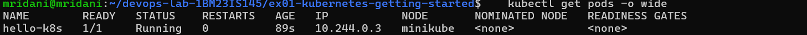
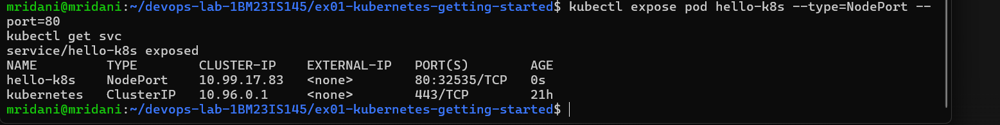
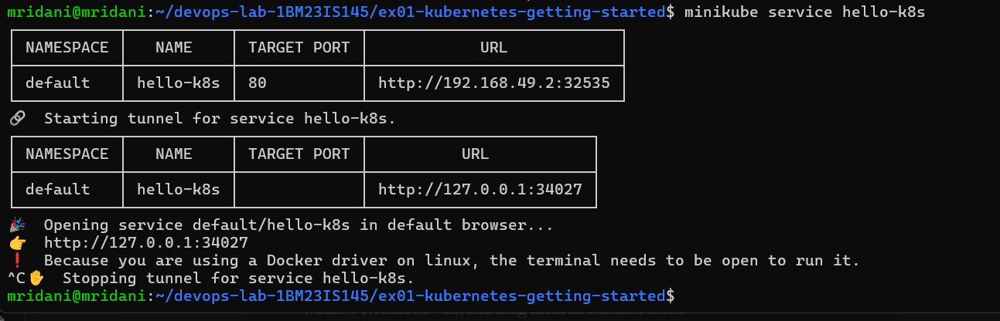
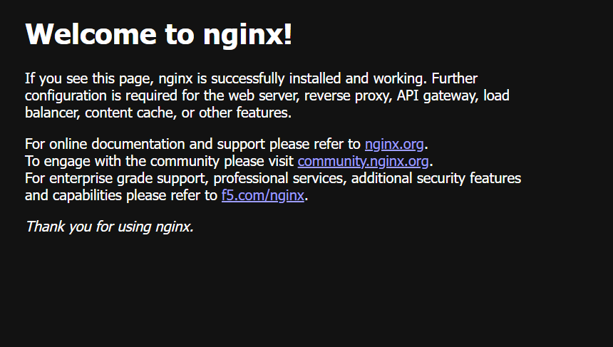

# Exercise 1: Kubernetes Getting Started (Hello Pod)

## Aim
Deploy a containerized web app (nginx, simulating a storefront page) as a Pod on a local Kubernetes cluster using Minikube, expose it as a Service and access it from the browser.

## Environment
Windows 11 + WSL2 (Ubuntu 24.04) + Docker Desktop, Minikube v1.39.0 (docker driver), Kubernetes v1.37.0, kubectl

## Steps
1. Start cluster: `minikube start`, verify with `kubectl get nodes` (status `Ready`)
2. Create Pod: `kubectl run hello-k8s --image=nginx --port=80`
3. Verify Pod: `kubectl get pods -o wide` (status `Running`, IP `10.244.0.3`)
4. Expose as Service: `kubectl expose pod hello-k8s --type=NodePort --port=80`, verify with `kubectl get svc` (NodePort `32535`)
5. Access in browser: `minikube service hello-k8s`
6. Clean up: `kubectl delete svc hello-k8s`, `kubectl delete pod hello-k8s`

## Note on accessing the Service (WSL2 + Docker driver)
`minikube service` first lists the NodePort URL `http://192.168.49.2:32535`, but that IP lives inside Docker Desktop's network and is not reachable from Windows. Minikube therefore starts a tunnel and provides `http://127.0.0.1:34027`, which works in the browser as long as the terminal stays open.

## Screenshots
1. Pod running: 
2. NodePort Service: 
3. Minikube service tunnel: 
4. nginx welcome page in browser: 

## Key Concepts
- **Pod** – the smallest deployable unit in Kubernetes; wraps one or more containers.
- **Service (NodePort)** – gives Pods a stable access point and exposes them on a port of every node (range 30000–32767).
- **Pod IP vs Service** – the Pod IP (`10.244.0.3`) is only reachable inside the cluster; the Service makes the app reachable from outside.
- **kubectl** – command-line client that talks to the Kubernetes API server.

## Result
Successfully deployed nginx as a Pod on Minikube, exposed it via a NodePort Service and accessed the welcome page from the browser.
