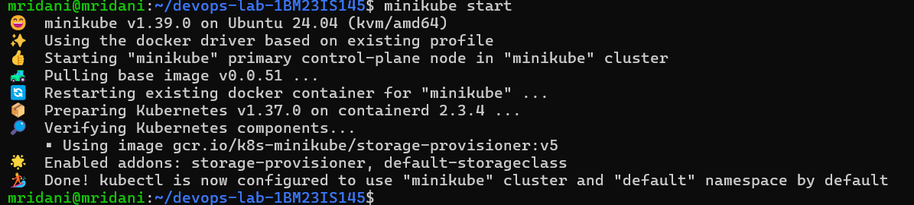
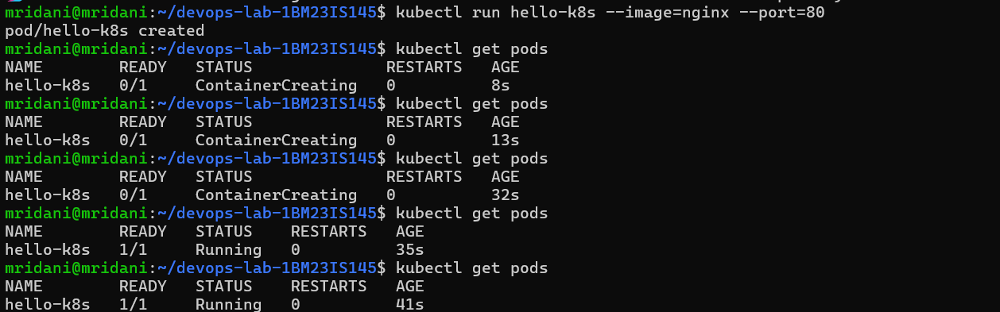
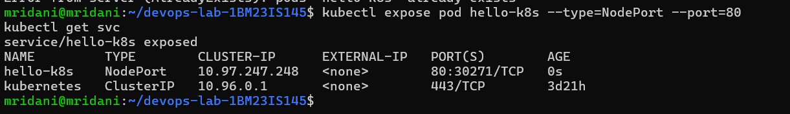
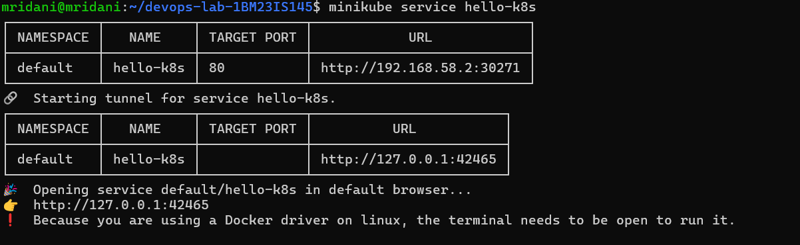
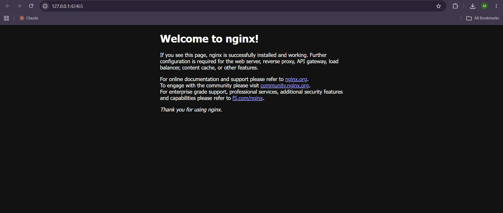

# Exercise 1: Kubernetes Getting Started – Hello Pod

## 1. Aim
Run a first application inside Kubernetes and access it: deploy the `nginx` image as a Pod on a local Minikube cluster, expose it as a NodePort Service and open it in the browser.

## 2. Problem Statement (from the manual)
A DevOps engineer at Zepto has to deploy the team's lightweight storefront / delivery-status web app on Kubernetes so that it is always running, portable and can be scaled later. The app is simulated with the `nginx` container image.

## 3. Environment
| Component | Details |
|---|---|
| Operating system | Windows 11 + WSL2 (Ubuntu 24.04) |
| Container platform | Docker Desktop |
| Kubernetes | Minikube v1.39.0 (docker driver), Kubernetes v1.37.0 |
| CLI | kubectl |
| Terminal | Ubuntu (WSL) |

## 4. Pre-requisites
Minikube and kubectl were installed in WSL beforehand, following the manual's pre-requisites (Minikube binary from `storage.googleapis.com/minikube/releases/latest/minikube-linux-amd64`, installed with `sudo install ... /usr/local/bin/minikube`). Docker Desktop provides the Docker driver, so VirtualBox is not needed.

## 5. Steps (in the order of the manual)

### Step 1: Start a local Kubernetes cluster with Minikube
**Command:**
```bash
minikube start
```
**Output:**
```text
😄  minikube v1.39.0 on Ubuntu 24.04 (kvm/amd64)
✨  Using the docker driver based on existing profile
👍  Starting "minikube" primary control-plane node in "minikube" cluster
🔄  Restarting existing docker container for "minikube" ...
📦  Preparing Kubernetes v1.37.0 on containerd 2.3.4 ...
🔎  Verifying Kubernetes components...
🌟  Enabled addons: storage-provisioner, default-storageclass
🏄  Done! kubectl is now configured to use "minikube" cluster and "default" namespace by default
```


### Step 2: Create the first Pod using the Nginx image
**Command:**
```bash
kubectl run hello-k8s --image=nginx --port=80
```
**Output:**
```text
pod/hello-k8s created
```
This creates a Pod named `hello-k8s` running one `nginx` container that listens on port 80.

### Step 3: Verify the Pod is running
**Command:**
```bash
kubectl get pods
```
**Output** (run a few times while the `nginx` image was being pulled):
```text
NAME        READY   STATUS              RESTARTS   AGE
hello-k8s   0/1     ContainerCreating   0          8s
...
NAME        READY   STATUS    RESTARTS   AGE
hello-k8s   1/1     Running   0          35s
```
The Pod goes from `ContainerCreating` (image being pulled) to `1/1 Running`.



### Step 4: Expose the Pod as a Service
**Commands:**
```bash
kubectl expose pod hello-k8s --type=NodePort --port=80
kubectl get svc
```
**Output:**
```text
service/hello-k8s exposed
NAME         TYPE        CLUSTER-IP      EXTERNAL-IP   PORT(S)        AGE
hello-k8s    NodePort    10.97.247.248   <none>        80:30271/TCP   0s
kubernetes   ClusterIP   10.96.0.1       <none>        443/TCP        3d21h
```
The Service `hello-k8s` maps port 80 of the Pod to NodePort `30271` on the node.



### Step 5: Open the app in the browser
**Command:**
```bash
minikube service hello-k8s
```
**Output:**
```text
| NAMESPACE |   NAME    | TARGET PORT |            URL            |
| default   | hello-k8s | 80          | http://192.168.58.2:30271 |
🔗  Starting tunnel for service hello-k8s.
| NAMESPACE |   NAME    | TARGET PORT |          URL           |
| default   | hello-k8s |             | http://127.0.0.1:42465 |
🎉  Opening service default/hello-k8s in default browser...
👉  http://127.0.0.1:42465
❗  Because you are using a Docker driver on linux, the terminal needs to be open to run it.
```


The browser shows the Nginx welcome page, as the manual expects:



**Note (WSL2 + Docker driver):** the NodePort URL `http://192.168.58.2:30271` lives inside Docker Desktop's network and cannot be reached from Windows, so Minikube opens a tunnel at `http://127.0.0.1:42465`. The tunnel works only while this terminal stays open.

### Clean up
```bash
kubectl delete svc hello-k8s
kubectl delete pod hello-k8s
```

## 6. Changes from the manual
None. All five steps were run exactly as written.

## 7. Key Concepts
- **Minikube** – runs a single-node Kubernetes cluster locally for learning and development.
- **Pod** – the smallest deployable unit in Kubernetes; here it wraps one `nginx` container.
- **Service (NodePort)** – gives Pods a stable access point and exposes them on a port of every node (range 30000–32767).
- **Pod IP vs Service** – a Pod's IP is reachable only inside the cluster; the Service makes the app reachable from outside.
- **kubectl** – the command-line client that talks to the Kubernetes API server.

## 8. Result
The `nginx` image was deployed as the Pod `hello-k8s` on Minikube, exposed through the NodePort Service `hello-k8s` (port `30271`) and opened in the browser, which showed the Nginx welcome page – the expected outcome of the manual.
