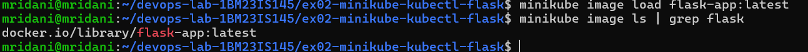
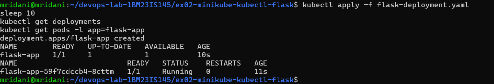
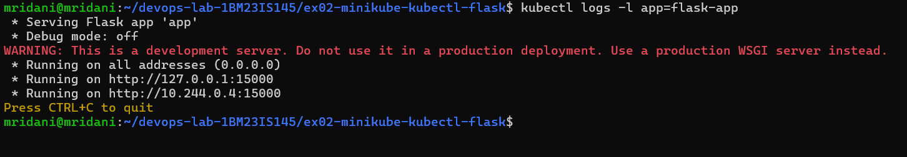
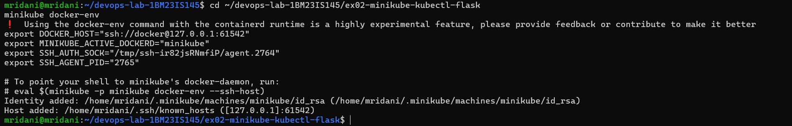
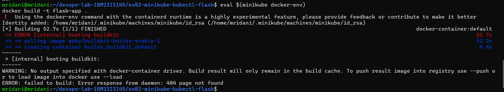
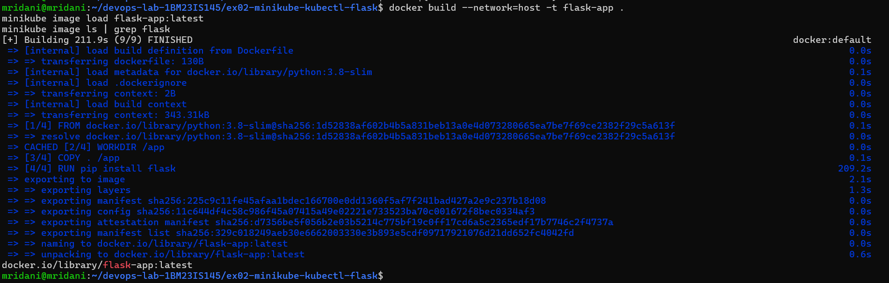
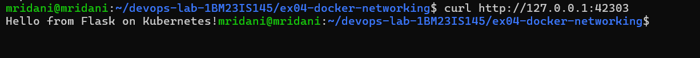

# Exercise 2: Deploy a Flask App on Minikube using kubectl and YAML

## Aim
Containerize a Flask application, deploy it on a single-node Minikube cluster using a Kubernetes Deployment defined in YAML, and expose it with a NodePort Service.

## Environment
Windows 11 + WSL2 (Ubuntu 24.04) + Docker Desktop, Minikube v1.39.0 (docker driver, containerd runtime), Kubernetes v1.37.0

## Files
- `app.py` – Flask app listening on port 15000
- `Dockerfile` – builds the `flask-app` image
- `flask-deployment.yaml` – Deployment (1 replica, `imagePullPolicy: Never`) + NodePort Service (port 15000 → targetPort 15000)

## Steps
1. Build the image: `docker build -t flask-app .`
2. Load it into Minikube: `minikube image load flask-app:latest`, verify with `minikube image ls | grep flask`
3. Deploy: `kubectl apply -f flask-deployment.yaml` (Deployment only at first)
4. Verify: `kubectl get deployments`, `kubectl get pods -l app=flask-app`
5. Inspect: `kubectl describe deployment flask-app`, `kubectl logs -l app=flask-app`
6. Try access without a Service: `curl http://127.0.0.1:15000` → fails
7. Add the Service section to the YAML and re-apply → `deployment unchanged`, `service created`
8. Get URL: `minikube service flask-app-service --url` → `http://127.0.0.1:46775`
9. In a second terminal: `curl http://127.0.0.1:46775` → `Hello from Flask on Kubernetes!`
10. Clean up: `kubectl delete -f flask-deployment.yaml`

## Change from the manual
The manual builds the image with `eval $(minikube docker-env)`. That only works when Minikube uses the Docker container runtime; this cluster uses **containerd**, so the image was built with the host Docker and then copied into the cluster with `minikube image load flask-app:latest`. With `imagePullPolicy: Never`, Kubernetes uses this local image instead of pulling from Docker Hub. Starting Minikube with `--container-runtime=docker` would let the manual step run exactly as written; it was not redone so that the cluster and screenshots here stay consistent.

## Screenshots
1. Image loaded into Minikube: 
2. Deployment and Pod running: 
3. Deployment description: 
4. Flask logs (listening on 15000): 
5. Access fails without a Service: 
6. Service created: 
7. Service URL via tunnel: 
8. curl succeeds: 
9. App in browser: 

## Questions
1. **Purpose of `minikube service flask-app-service --url`?** Gives a URL to reach the Service running inside Minikube.
2. **What happens when it runs?** Minikube checks the Service exists, starts a tunnel (Docker driver) and prints the URL.
3. **Why use `targetPort`?** It is the port the container actually listens on (15000).
4. **`port` vs `targetPort`?** `port` is the Service's own port; `targetPort` is the container's port the Service forwards to.
5. **How to access a Flask app in Minikube?** Expose it with a Service and use `minikube service <name> --url`.
6. **Why must the terminal stay open?** With the Docker driver, the tunnel lives in that terminal; closing it closes the tunnel.
7. **Benefit of `--url`?** Prints the URL without trying to open a browser, so it can be used with curl.
8. **Command to expose a Service?** `kubectl expose ...` or `kubectl apply -f <yaml with a Service>`.
9. **How does Minikube help?** Runs a single-node Kubernetes cluster locally for testing.
10. **Role of kubectl?** CLI to talk to the Kubernetes API: deploy, inspect, scale and delete resources.

## Result
The Flask app was deployed on Minikube via a YAML Deployment, was unreachable until a NodePort Service was added, and then responded with `Hello from Flask on Kubernetes!`.

## Evidence: the manual's Step 4 and Dockerfile (run exactly as written)
| Manual step | Result | Screenshot |
|---|---|---|
| `minikube docker-env` | Runs, but warns: *"Using the docker-env command with the containerd runtime is a highly experimental feature"* |  |
| `eval $(minikube docker-env)` then `docker build -t flask-app .` | `ERROR: failed to build: Error response from daemon: 404 page not found` – images cannot be built inside a containerd-based Minikube this way |  |
| Manual's Dockerfile (`COPY . /app`), built on the host and loaded with `minikube image load` | Image `flask-app:latest` available in the cluster |  |
| Deployment + Service, `curl` via `minikube service --url` | `Hello from Flask on Kubernetes!` |  |

All files in this folder (`app.py`, `Dockerfile`, `flask-deployment.yaml`) are now identical to the manual. The only change is *how* the image reaches the cluster: `minikube image load` instead of `eval $(minikube docker-env)`.
