# Exercise 2: Deploy a Flask App on Minikube using kubectl and YAML

## 1. Aim
Set up a single-node Kubernetes cluster with Minikube and deploy a Python Flask application on it using a Deployment defined in YAML, then expose it with a NodePort Service.

## 2. Environment
| Component | Details |
|---|---|
| Operating system | Windows 11 + WSL2 (Ubuntu 24.04) |
| Container platform | Docker Desktop |
| Kubernetes | Minikube v1.39.0 (docker driver, **Docker runtime**), Kubernetes v1.37.0 |
| CLI | kubectl |

## 3. Files in this folder
| File | Purpose |
|---|---|
| `app.py` | Flask app listening on port 15000 (identical to the manual) |
| `Dockerfile` | Builds the `flask-app` image (identical to the manual) |
| `flask-deployment.yaml` | Deployment + NodePort Service, final version from Step 13 (identical to the manual) |

## 4. Steps (in the order of the manual)

### Step 1: Start Minikube
```bash
minikube start --container-runtime=docker
```
```text
😄  minikube v1.39.0 on Ubuntu 24.04 (kvm/amd64)
✨  Automatically selected the docker driver
👍  Starting "minikube" primary control-plane node in "minikube" cluster
🔥  Creating docker container (CPUs=2, Memory=3072MB) ...
🐳  Preparing Kubernetes v1.37.0 on Docker 29.7.2 ...
🔎  Verifying Kubernetes components...
🏄  Done! kubectl is now configured to use "minikube" cluster and "default" namespace by default
```
`--container-runtime=docker` was added because Minikube v1.39.0 uses the **containerd** runtime by default, and the manual's Step 4 (`eval $(minikube docker-env)` + `docker build`) only works with the Docker runtime. With containerd the build failed with `404 page not found`; with the Docker runtime it runs exactly as written.

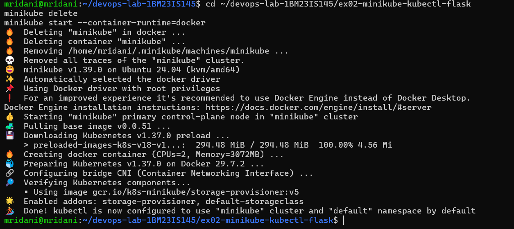

### Step 2: Create a Flask application
`app.py`:
```python
from flask import Flask
app = Flask(__name__)

@app.route('/')
def home():
    return "Hello from Flask on Kubernetes!"

if __name__ == '__main__':
    app.run(host='0.0.0.0', port=15000)
```

### Step 3: Create a Dockerfile for the Flask application
`Dockerfile`:
```dockerfile
FROM python:3.8-slim
WORKDIR /app
COPY . /app
RUN pip install flask
CMD ["python", "app.py"]
```

### Step 4: Build the Docker image with Minikube's Docker daemon
**Commands, exactly as in the manual:**
```bash
minikube docker-env
eval $(minikube docker-env)
docker build -t flask-app .
```
**Output:**
```text
export DOCKER_TLS_VERIFY="1"
export DOCKER_HOST="tcp://127.0.0.1:50064"
export DOCKER_CERT_PATH="/home/mridani/.minikube/certs"
export MINIKUBE_ACTIVE_DOCKERD="minikube"
...
[+] Building 28.7s (10/10) FINISHED
 => [1/4] FROM docker.io/library/python:3.8-slim
 => [2/4] WORKDIR /app
 => [3/4] COPY . /app
 => [4/4] RUN pip install flask
 => => naming to docker.io/library/flask-app
```
After `eval $(minikube docker-env)` the `docker` command talks to the Docker daemon **inside Minikube**, so the image is built directly in the cluster.

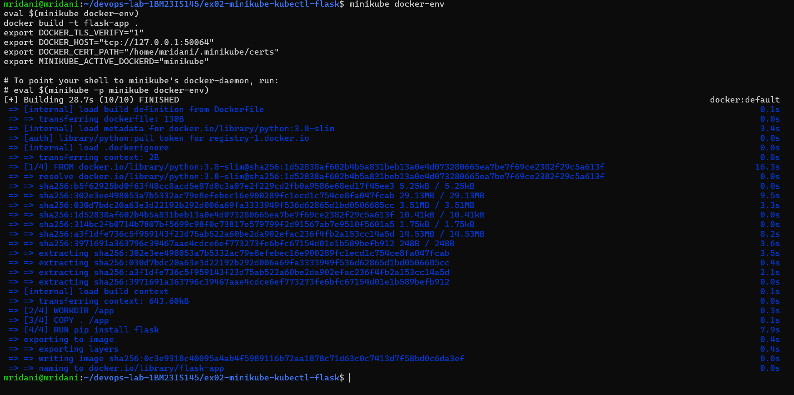

### Step 5: Create the Kubernetes Deployment YAML file
`flask-deployment.yaml` (Deployment part, as in the manual):
```yaml
apiVersion: apps/v1
kind: Deployment
metadata:
  name: flask-app
spec:
  replicas: 1
  selector:
    matchLabels:
      app: flask-app
  template:
    metadata:
      labels:
        app: flask-app
    spec:
      containers:
      - name: flask-app
        image: flask-app:latest
        imagePullPolicy: Never
        ports:
        - containerPort: 15000
```

### Step 6: Deploy the application
### Step 7: Check deployment status
### Step 8: Verify Pods created by the Deployment
**Commands** (in the same terminal, so `docker images` lists Minikube's images):
```bash
docker images | grep flask-app
kubectl apply -f flask-deployment.yaml
kubectl get deployments
kubectl get pods
```
**Output:**
```text
flask-app:latest   0c3e9318c400   137MB
deployment.apps/flask-app created
service/flask-app-service created
NAME        READY   UP-TO-DATE   AVAILABLE   AGE
flask-app   0/1     1            0           1s
NAME                         READY   STATUS              RESTARTS   AGE
flask-app-59f7cdccb4-vpxr7   0/1     ContainerCreating   0          1s
...
NAME                         READY   STATUS    RESTARTS   AGE
flask-app-59f7cdccb4-vpxr7   1/1     Running   0          26s
```
The image built in Step 4 is inside Minikube, and because of `imagePullPolicy: Never` Kubernetes uses it instead of pulling from Docker Hub. (The applied file is the final version from Step 13, so the Service is created too; Step 12 below shows the state before the Service existed.)

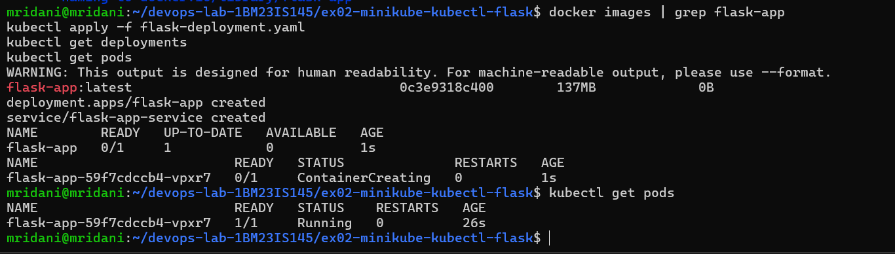

### Step 9: Describe the Deployment
**Command:**
```bash
kubectl describe deployment flask-app
```
**Key output:**
```text
Name:                   flask-app
Namespace:              default
Selector:               app=flask-app
Replicas:               1 desired | 1 updated | 1 total | 1 available | 0 unavailable
StrategyType:           RollingUpdate
  Containers:
   flask-app:
    Image:         flask-app:latest
    Port:          15000/TCP
Conditions:
  Available      True    MinimumReplicasAvailable
  Progressing    True    NewReplicaSetAvailable
NewReplicaSet:   flask-app-59f7cdccb4 (1/1 replicas created)
Events:
  Normal  ScalingReplicaSet  34s  deployment-controller  Scaled up replica set flask-app-59f7cdccb4 from 0 to 1
```
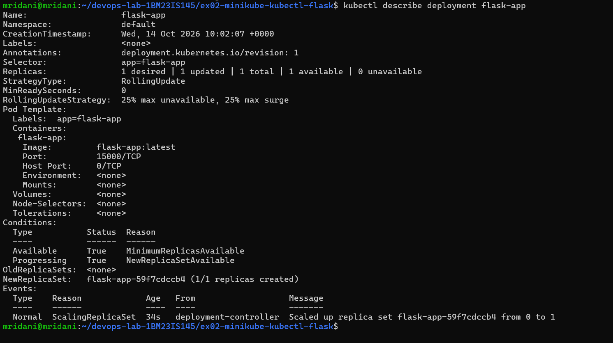

### Step 10: View deployment logs
**Command:**
```bash
kubectl logs flask-app-59f7cdccb4-vpxr7
```
**Output:**
```text
 * Serving Flask app 'app'
 * Debug mode: off
 * Running on all addresses (0.0.0.0)
 * Running on http://127.0.0.1:15000
 * Running on http://10.244.0.3:15000
Press CTRL+C to quit
```
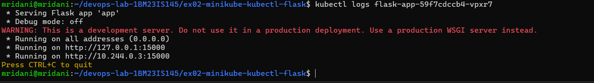

### Step 11: Check Services
### Step 12: Try to access the Flask service on port 15000
**Commands:**
```bash
kubectl get services
curl http://127.0.0.1:15000
```
**Output:**
```text
NAME         TYPE        CLUSTER-IP   EXTERNAL-IP   PORT(S)   AGE
kubernetes   ClusterIP   10.96.0.1    <none>        443/TCP   21h
curl: (7) Failed to connect to 127.0.0.1 port 15000 after 0 ms: Couldn't connect to server
```
As the manual explains, the connection fails because the app exposes port 15000 only inside the cluster and no Service exists yet.

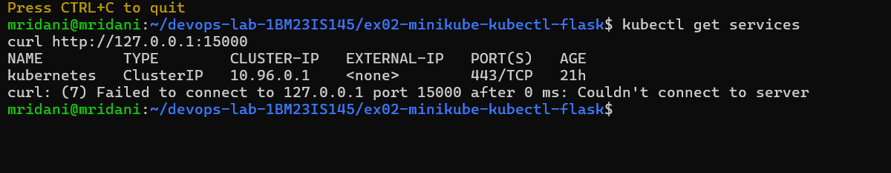

### Step 13: Update the deployment file with a Service section
The Service section is added to `flask-deployment.yaml`:
```yaml
---
apiVersion: v1
kind: Service
metadata:
  name: flask-app-service
spec:
  selector:
    app: flask-app
  ports:
  - port: 15000
    targetPort: 15000
  type: NodePort
```
**Commands:**
```bash
kubectl apply -f flask-deployment.yaml
kubectl get services
```
**Output:**
```text
deployment.apps/flask-app unchanged
service/flask-app-service created
NAME                TYPE        CLUSTER-IP       EXTERNAL-IP   PORT(S)           AGE
flask-app-service   NodePort    10.106.245.196   <none>        15000:31968/TCP   0s
kubernetes          ClusterIP   10.96.0.1        <none>        443/TCP           21h
```
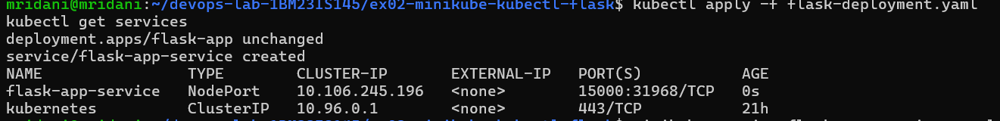

Get the URL of the Service:
```bash
minikube service flask-app-service --url
```
**Output:**
```text
http://127.0.0.1:46775
❗  Because you are using a Docker driver on linux, the terminal needs to be open to run it.
```
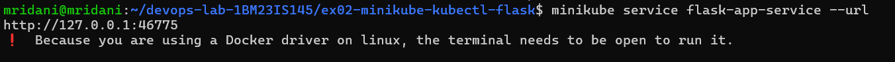

In a second terminal:
```bash
curl http://127.0.0.1:46775
```
**Output:**
```text
Hello from Flask on Kubernetes!
```
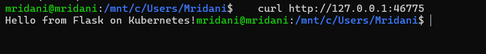

The app also opens in the browser:

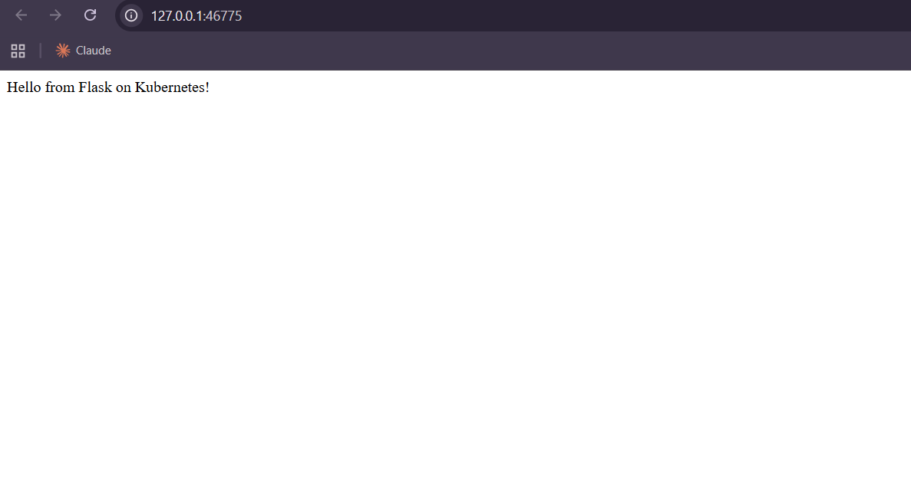

With the image built inside Minikube (Steps 1–10 above), the Service works the same way:
```bash
minikube service flask-app-service --url      # http://127.0.0.1:34303
curl http://127.0.0.1:34303                    # in a second terminal
```
```text
Hello from Flask on Kubernetes!
```
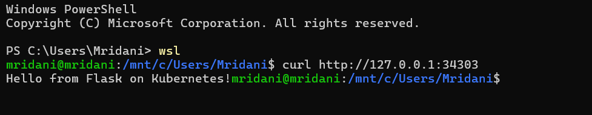

### Clean up
```bash
kubectl delete -f flask-deployment.yaml
```

## 5. Changes from the manual
| Manual | What happened | What was done |
|---|---|---|
| Step 1: `minikube start` | Minikube v1.39.0 defaults to the containerd runtime, where Step 4's `docker-env` build fails with `404 page not found` | `minikube start --container-runtime=docker`; all other commands run exactly as written |

All files in this folder (`app.py`, `Dockerfile`, `flask-deployment.yaml`) are identical to the manual.

## 6. Q&A
1. **What is the purpose of `minikube service flask-app-service --url`?** It gives a URL to reach the Service running inside Minikube.
2. **What happens when it runs?** Minikube checks that the Service exists and is exposed, starts a tunnel (Docker driver) and prints the URL.
3. **Why is `targetPort` used?** It is the port the container actually listens on (15000).
4. **`port` vs `targetPort`?** `port` is the Service's own port; `targetPort` is the container port the Service forwards to.
5. **How do you access a Flask app running in Minikube?** Expose it with a Service and use `minikube service <name> --url`.
6. **Why must the terminal stay open with the Docker driver?** The tunnel runs in that terminal; closing it closes the tunnel.
7. **Benefit of `--url`?** It prints the URL instead of opening a browser, so it can be used with curl.
8. **Command to expose a Service?** `kubectl expose ...` or `kubectl apply -f <yaml with a Service>`.
9. **How does Minikube help?** It runs a single-node Kubernetes cluster locally for testing.
10. **Role of kubectl?** The CLI to talk to the Kubernetes API: deploy, inspect, scale and delete resources.

## 7. Result
The Flask app was deployed on Minikube with a YAML Deployment, was unreachable until a NodePort Service was added (Step 12), and then responded with `Hello from Flask on Kubernetes!` – the manual's expected result.
