# Exercise 3: Scaling a Flask App on a Single Node using ReplicaSets

## Aim
Run multiple identical Pods of a "flash sale" Flask app with a ReplicaSet, scale them up for a traffic spike, observe self-healing when a Pod is deleted, and verify that a Service distributes requests across Pods.

## Environment
Windows 11 + WSL2 (Ubuntu 24.04) + Docker Desktop, Minikube v1.39.0 (docker driver, containerd runtime), Kubernetes v1.37.0

## Files
- `app.py` – flash sale app: `/` (welcome), `/buy` (checkout, returns `served_by_pod`), `/health` (probes)
- `Dockerfile` – runs the app with gunicorn on port 5000
- `flashsale-replicaset.yaml` – ReplicaSet (3 replicas, readiness/liveness probes, CPU/memory limits) + ClusterIP Service

## Steps
0. Fresh single-node cluster (manual Steps 1-2): `minikube stop`, `minikube delete`, `minikube start --nodes=1`, `kubectl get nodes` (1 node, `Ready`)
1. Build image: `docker build -t flashsale:1.0 .`
2. Load into Minikube: `minikube image load flashsale:1.0`
3. Apply: `kubectl apply -f flashsale-replicaset.yaml` → 3 Pods running
4. Scale: `kubectl scale rs flashsale-rs --replicas=5` → 5 Pods
5. Self-healing: `kubectl delete pod flashsale-rs-gz25l` → replaced by `flashsale-rs-64l9r`, still 5 Pods
6. Distribution: `kubectl get pods -o wide` → all 5 Pods on node `minikube`
7. Load test from inside the cluster:
   `kubectl run buyer --image=curlimages/curl --rm -it --restart=Never -- sh -c 'for i in 1 2 3 4 5 6 7 8 9 10; do curl -s flashsale-svc/buy; echo; done'`
8. Clean up: `kubectl delete -f flashsale-replicaset.yaml`

## Fixes made to the manual's version
| Manual | Problem | Fix |
|---|---|---|
| `COPY ex3-flash-sale.py` but gunicorn runs `app:app` | gunicorn cannot import `app`, Pod crashes | File saved as `app.py` |
| `docker push` to Docker Hub | Needs a registry account; not needed locally | `minikube image load flashsale:1.0` |
| YAML applied before the image is built | Pods fail to find the image | Build and load first, then apply |
| ReplicaSet named `flashsale-rs`, later commands use `flask-app-rs` | `NotFound` error | Used `flashsale-rs` throughout |

## Screenshots
0. Fresh single-node cluster: 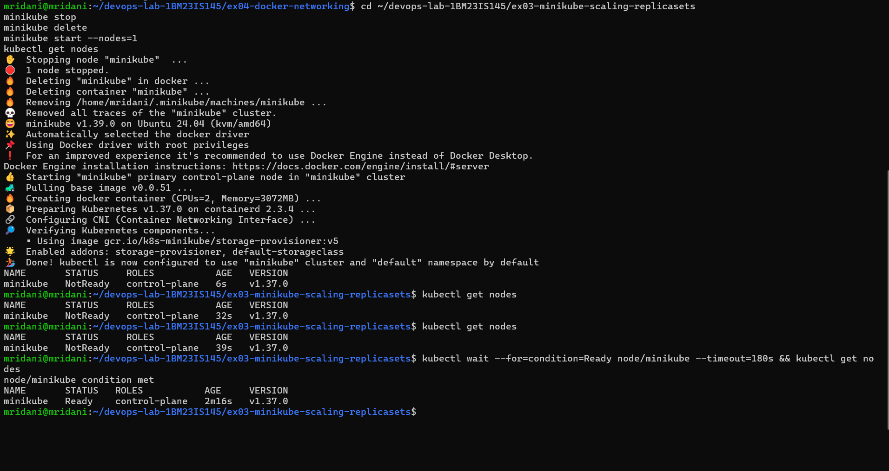
1. Image loaded into Minikube: 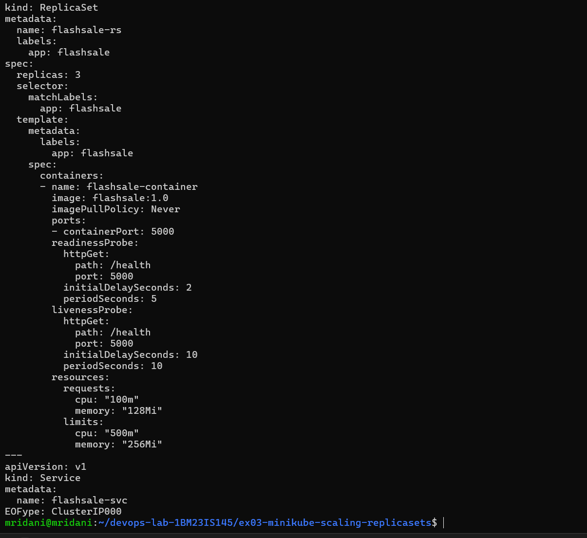
2. ReplicaSet with 3 Pods: 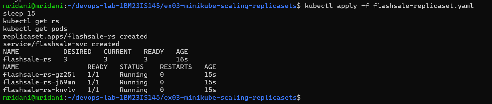
3. Scaled to 5 Pods: 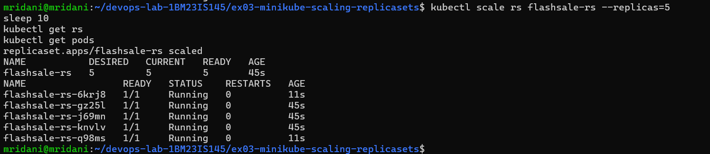
4. Self-healing after deleting a Pod: 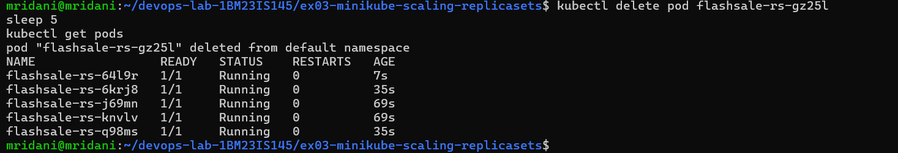
5. Pod distribution across nodes: 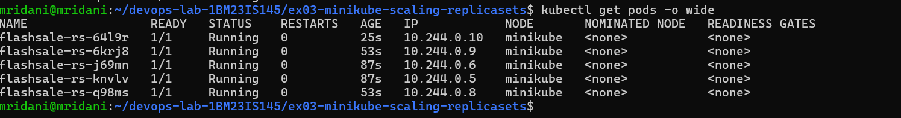
6. Requests served by different Pods: 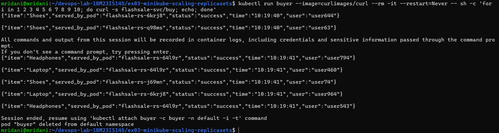

## Observations
- Scaling from 3 to 5 created 2 new Pods (`6krj8`, `q98ms`) in seconds.
- Deleting `gz25l` caused the ReplicaSet to immediately create `64l9r`, keeping 5 Pods.
- 7 checkout requests through `flashsale-svc` were served by 4 different Pods (`6krj8`, `q98ms`, `64l9r`, `j69mn`), showing load distribution.

## Questions
1. **Initial number of replicas?** 3
2. **Pods running after applying?** 3
3. **Scaling to 5?** Kubernetes creates 2 more Pods to reach the desired count.
4. **Deleting one Pod?** The ReplicaSet creates a replacement, keeping 5 running.
5. **How is the desired count maintained?** The ReplicaSet controller continuously compares actual vs desired Pods and creates/deletes Pods to match.
6. **Nodes running?** 1 (`minikube`)
7. **Where are the Pods?** All 5 on the single node `minikube`, each with its own IP (10.244.0.x).

## Result
The flash sale app was scaled from 3 to 5 replicas, recovered automatically from a deleted Pod, and its Service distributed requests across multiple Pods.

## Evidence: the manual's original version (run exactly as written)
The manual's Dockerfile and file name are kept in [`manual-original/`](manual-original/). `flashsale-replicaset.yaml` is now identical to the manual (the extra `imagePullPolicy: Never` was removed).

| Manual step | Result | Screenshot |
|---|---|---|
| Apply the YAML (Step 4) before building/loading the image (Step 5) | Pods stuck in `ContainerCreating` → `ImagePullBackOff`: `Failed to pull image "docker.io/library/flashsale:1.0"` – Kubernetes looks for the image on Docker Hub | 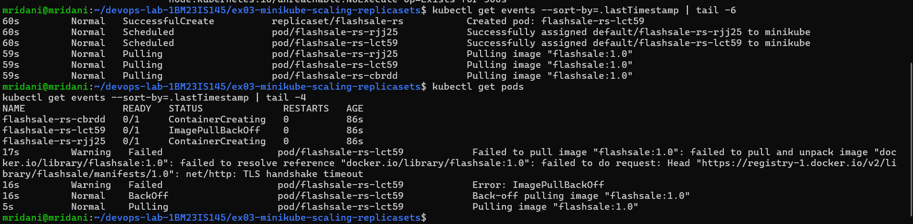 |
| After `minikube image load flashsale:1.0`, pods deleted and recreated by the ReplicaSet | All 3 pods `Running`, without `imagePullPolicy: Never` | 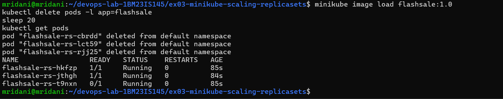 |
| `kubectl scale rs flask-app-rs --replicas=5` | `Error from server (NotFound): replicasets.apps "flask-app-rs" not found` – the YAML creates `flashsale-rs` | 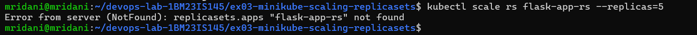 |
| Manual's Dockerfile (`COPY ex3-flash-sale.py .`) | Builds successfully | 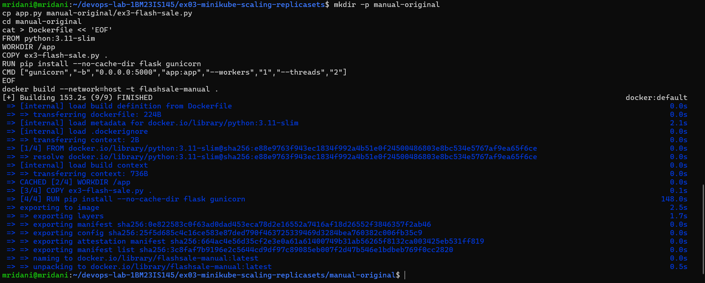 |
| Run the manual's image | `ModuleNotFoundError: No module named 'app'` → `Worker failed to boot` – gunicorn runs `app:app` but the file is `ex3-flash-sale.py` | 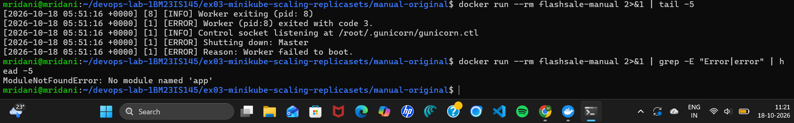 |
