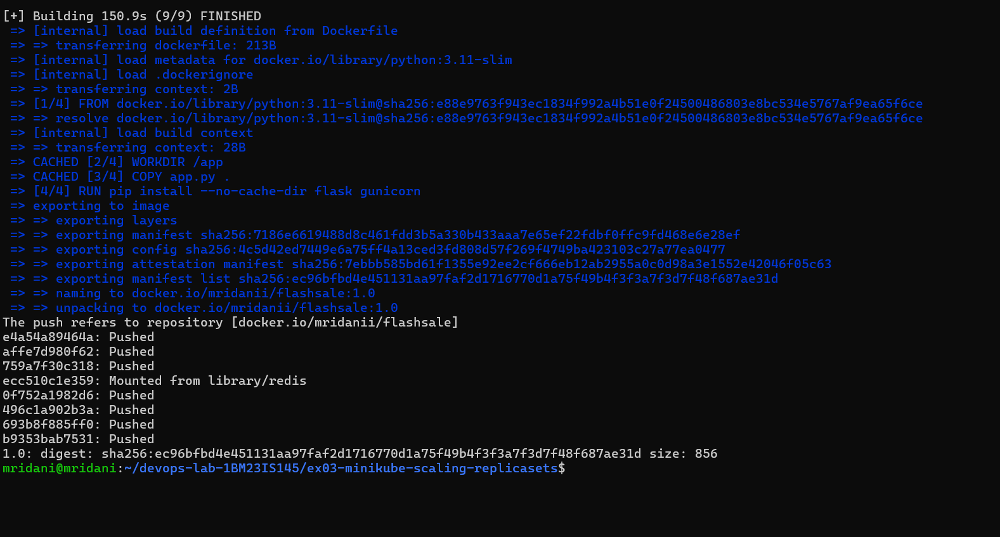

# Exercise 3: Scaling a Flask App on a Single Node using ReplicaSets

## 1. Aim
Understand ReplicaSets and Pods by running a "flash sale" Flask app as a ReplicaSet, scaling it from 3 to 5 Pods, observing self-healing when a Pod is deleted, and observing how the Pods are distributed.

## 2. Use Case (from the manual)
During a flash sale (Flipkart Big Billion Days, Amazon Prime Day) traffic can jump from 100 to 10,000 requests per minute. A single Pod would crash; a ReplicaSet runs many identical Pods of the same app, spreads the requests across them and can scale back down after the sale.

## 3. Environment
| Component | Details |
|---|---|
| Operating system | Windows 11 + WSL2 (Ubuntu 24.04) |
| Container platform | Docker Desktop |
| Kubernetes | Minikube v1.39.0 (docker driver, containerd runtime), Kubernetes v1.37.0 |
| Registry | Docker Hub (`mridanii/flashsale`) |

## 4. Files in this folder
| File | Purpose |
|---|---|
| `app.py` | Flash sale app: `/` (welcome), `/buy` (checkout, returns `served_by_pod`), `/health` (probes) – identical to the manual |
| `Dockerfile` | Runs the app with gunicorn on port 5000 (copies `app.py`, see Section 6) |
| `flashsale-replicaset.yaml` | ReplicaSet (3 replicas, probes, CPU/memory limits) + ClusterIP Service – identical to the manual |
| `manual-original/` | The manual's Dockerfile and file name `ex3-flash-sale.py`, kept to show why they fail |

## 5. Steps (in the order of the manual)

### Create the app
`app.py` (identical to the manual):
```python
# app.py
from flask import Flask, request
import socket, time, random

app = Flask(__name__)

@app.get("/")
def homepage():
    return {
        "message": "Welcome to Big Sale!",
        "pod": socket.gethostname(),
        "ts": time.time()
    }

@app.get("/buy")
def buy():
    # simulate a flash sale checkout
    item = random.choice(["Smartphone", "Shoes", "Headphones", "Laptop"])
    user = request.args.get("user", f"user{random.randint(1,1000)}")
    return {
        "status": "success",
        "item": item,
        "user": user,
        "served_by_pod": socket.gethostname(),
        "time": time.strftime("%H:%M:%S")
    }

@app.get("/health")
def health():
    return {"status": "healthy", "pod": socket.gethostname()}
```

### Create the Dockerfile
```dockerfile
FROM python:3.11-slim
WORKDIR /app
COPY app.py .
RUN pip install --no-cache-dir flask gunicorn
CMD ["gunicorn","-b","0.0.0.0:5000","app:app","--workers","1","--threads","2"]
```
The manual's Dockerfile copies `ex3-flash-sale.py`, but its `CMD` starts `app:app`, which needs a file called `app.py`. The manual's version builds, but the container crashes:
```text
[ERROR] Worker (pid:8) exited with code 3.
[ERROR] Reason: Worker failed to boot.
ModuleNotFoundError: No module named 'app'
```


So the file is saved as `app.py` and copied as `app.py` (the only change to the Dockerfile).

### Build the Docker image and push it to Docker Hub
**Commands** (`<your-dockerhub-username>` = `mridanii`):
```bash
docker build -t mridanii/flashsale:1.0 .
docker push mridanii/flashsale:1.0
```
**Output (end):**
```text
naming to docker.io/mridanii/flashsale:1.0
The push refers to repository [docker.io/mridanii/flashsale]
1.0: digest: sha256:ec96bfbd4e451131aa97faf2d1716770d1a75f49b4f3f3a7f3d7f48f687ae31d size: 856
```
The image is public at https://hub.docker.com/r/mridanii/flashsale.



### Step 1: Clean up the previous Minikube cluster
### Step 2: Start Minikube with a single node
**Commands:**
```bash
minikube stop
minikube delete
minikube start --nodes=1
kubectl get nodes
```
**Output (end):**
```text
💀  Removed all traces of the "minikube" cluster.
🏄  Done! kubectl is now configured to use "minikube" cluster and "default" namespace by default
NAME       STATUS   ROLES           AGE     VERSION
minikube   Ready    control-plane   2m16s   v1.37.0
```
One node, `minikube`, is `Ready`.


### Step 3: Create `flashsale-replicaset.yaml`
The file is identical to the manual: a ReplicaSet `flashsale-rs` with `replicas: 3`, image `flashsale:1.0`, readiness/liveness probes on `/health` and CPU/memory limits, plus a ClusterIP Service `flashsale-svc` (port 80 → 5000).

### Step 4: Apply the ReplicaSet configuration
**Command:**
```bash
kubectl apply -f flashsale-replicaset.yaml
```
**Output:**
```text
replicaset.apps/flashsale-rs created
service/flashsale-svc created
```
**Following the manual's order exactly** (apply before the image exists in the cluster), the Pods cannot start, because Kubernetes tries to pull `flashsale:1.0` from Docker Hub:
```text
flashsale-rs-cbrdd   0/1   ContainerCreating   0   86s
flashsale-rs-lct59   0/1   ImagePullBackOff    0   86s
flashsale-rs-rjj25   0/1   ContainerCreating   0   86s
Warning  Failed  pod/flashsale-rs-lct59  Failed to pull image "flashsale:1.0": ... "docker.io/library/flashsale:1.0" ...
```


### Step 5: Build the image and make it available to Minikube
The manual builds inside Minikube (`eval $(minikube docker-env)`, `docker build -t flask-app .`). Two problems: the tag `flask-app` does not match the image `flashsale:1.0` in the YAML, and building through `docker-env` fails on this containerd-based cluster (shown in Exercise 2). The image is therefore built as `flashsale:1.0` and copied into Minikube:
```bash
docker build -t flashsale:1.0 .
minikube image load flashsale:1.0
kubectl delete pods -l app=flashsale
kubectl get pods
```
The ReplicaSet immediately recreates the deleted Pods, now with the image available:
```text
pod "flashsale-rs-cbrdd" deleted from default namespace
pod "flashsale-rs-lct59" deleted from default namespace
pod "flashsale-rs-rjj25" deleted from default namespace
NAME                 READY   STATUS    RESTARTS   AGE
flashsale-rs-hkfzp   1/1     Running   0          85s
flashsale-rs-jthgh   1/1     Running   0          84s
flashsale-rs-t9nxn   0/1     Running   0          85s
```


### Step 6: Verify the Pods
*(The screenshots for Steps 6–11 come from the complete run of the exercise, so the Pod names differ from Step 5.)*

**Commands:**
```bash
kubectl get rs
kubectl get pods
```
**Output:**
```text
NAME           DESIRED   CURRENT   READY   AGE
flashsale-rs   3         3         3       16s
NAME                 READY   STATUS    RESTARTS   AGE
flashsale-rs-gz25l   1/1     Running   0          15s
flashsale-rs-j69mn   1/1     Running   0          15s
flashsale-rs-knvlv   1/1     Running   0          15s
```


### Step 7: Scale the ReplicaSet to 5 replicas
The manual's command uses the name `flask-app-rs`, but the YAML creates `flashsale-rs`:
```bash
kubectl scale rs flask-app-rs --replicas=5
```
```text
Error from server (NotFound): replicasets.apps "flask-app-rs" not found
```


With the correct name:
```bash
kubectl scale rs flashsale-rs --replicas=5
```

### Step 8: Verify the updated ReplicaSet
### Step 9: Verify the updated Pods
**Commands:**
```bash
kubectl get rs
kubectl get pods
```
**Output:**
```text
replicaset.apps/flashsale-rs scaled
NAME           DESIRED   CURRENT   READY   AGE
flashsale-rs   5         5         5       45s
NAME                 READY   STATUS    RESTARTS   AGE
flashsale-rs-6krj8   1/1     Running   0          11s
flashsale-rs-gz25l   1/1     Running   0          45s
flashsale-rs-j69mn   1/1     Running   0          45s
flashsale-rs-knvlv   1/1     Running   0          45s
flashsale-rs-q98ms   1/1     Running   0          11s
```
Two new Pods (`6krj8`, `q98ms`) were created to reach 5.


### Step 10: Delete one Pod
### Step 11: Verify the Pods
**Commands:**
```bash
kubectl delete pod flashsale-rs-gz25l
kubectl get pods
```
**Output:**
```text
pod "flashsale-rs-gz25l" deleted from default namespace
NAME                 READY   STATUS    RESTARTS   AGE
flashsale-rs-64l9r   1/1     Running   0          7s
flashsale-rs-6krj8   1/1     Running   0          35s
flashsale-rs-j69mn   1/1     Running   0          69s
flashsale-rs-knvlv   1/1     Running   0          69s
flashsale-rs-q98ms   1/1     Running   0          35s
```
The ReplicaSet replaced `gz25l` with a new Pod `64l9r` within seconds, keeping 5 Pods.


**Pod distribution** (manual tip: `kubectl get pods -o wide`):
```text
NAME                 READY   STATUS    RESTARTS   AGE   IP            NODE
flashsale-rs-64l9r   1/1     Running   0          25s   10.244.0.10   minikube
flashsale-rs-6krj8   1/1     Running   0          53s   10.244.0.9    minikube
flashsale-rs-j69mn   1/1     Running   0          87s   10.244.0.6    minikube
flashsale-rs-knvlv   1/1     Running   0          87s   10.244.0.5    minikube
flashsale-rs-q98ms   1/1     Running   0          53s   10.244.0.8    minikube
```
All 5 Pods run on the single node `minikube`, each with its own IP.


### Additional check: requests are spread across the Pods
```bash
kubectl run buyer --image=curlimages/curl --rm -it --restart=Never -- sh -c 'for i in 1 2 3 4 5 6 7 8 9 10; do curl -s flashsale-svc/buy; echo; done'
```
The checkout requests through `flashsale-svc` were answered by different Pods (`served_by_pod`: `6krj8`, `q98ms`, `64l9r`, `j69mn`):
```text
{"item":"Shoes","served_by_pod":"flashsale-rs-6krj8","status":"success","time":"10:19:40","user":"user644"}
{"item":"Shoes","served_by_pod":"flashsale-rs-q98ms","status":"success","time":"10:19:40","user":"user63"}
{"item":"Headphones","served_by_pod":"flashsale-rs-64l9r","status":"success","time":"10:19:41","user":"user794"}
{"item":"Shoes","served_by_pod":"flashsale-rs-j69mn","status":"success","time":"10:19:41","user":"user74"}
```


### Clean up
```bash
kubectl delete -f flashsale-replicaset.yaml
```

## 6. Changes from the manual
| Manual | What happened (screenshot above) | What was done |
|---|---|---|
| Dockerfile `COPY ex3-flash-sale.py .` | gunicorn `ModuleNotFoundError: No module named 'app'` | File saved and copied as `app.py` |
| Step 4 (apply) before Step 5 (build) | `ImagePullBackOff` – image not in the cluster yet | Image loaded with `minikube image load`, Pods recreated by the ReplicaSet |
| Step 5: `docker build -t flask-app .` inside Minikube | Tag does not match `flashsale:1.0`; `docker-env` build fails on containerd | Built as `flashsale:1.0` on the host and loaded into Minikube |
| Step 7: `kubectl scale rs flask-app-rs` | `NotFound` – the YAML creates `flashsale-rs` | `kubectl scale rs flashsale-rs --replicas=5` |

## 7. Q&A
1. **What is the initial number of replicas in the ReplicaSet?** 3
2. **How many Pods are running after applying the ReplicaSet configuration?** 3
3. **What happens when you scale the ReplicaSet to 5 replicas?** Kubernetes creates 2 more Pods (`6krj8`, `q98ms`) to reach 5.
4. **What happens when you delete one Pod?** The ReplicaSet creates a replacement (`64l9r`), keeping 5 Pods.
5. **How does Kubernetes maintain the desired number of replicas?** The ReplicaSet controller continuously compares running Pods with the desired count and creates or deletes Pods to match.
6. **How many nodes are running?** 1 (`minikube`).
7. **Where are the Pods running?** All 5 on the single node `minikube`, each with its own IP (`10.244.0.x`).

## 8. Result
The flash sale app ran as a ReplicaSet of 3 Pods, was scaled to 5, recovered automatically when a Pod was deleted, and its Service spread checkout requests across several Pods – the manual's expected outcomes.
