# Exercise 4: Docker Networking with Multiple Containers

## 1. Aim
Build and verify a three-container application (Flask API, MySQL database, Redis cache) on a user-defined Docker bridge network, understand host-to-container port publishing, and demonstrate container-to-container DNS / service discovery.

## 2. Instructions followed
The manual's Exercise 4 page ends with *"Detailed steps for the lab exercise can be found at"* a Google Doc: **Docker Networking Lab – Complete Part 0–27 Practical Walkthrough**. This README follows that walkthrough part by part. Where the walkthrough and the short manual page differ, the walkthrough was followed:

| Item | Manual page (GitHub) | Detailed walkthrough (followed) |
|---|---|---|
| `app.py` run line | `app.run(debug=True, port=5001)` | `app.run(host='0.0.0.0', port=5001)` |
| `requirements.txt` | `Flask==2.0.1` | `Flask==2.0.1` + `Werkzeug==2.0.3` |
| MySQL | no password | `MYSQL_ROOT_PASSWORD=rootpass`, `MYSQL_DATABASE=devopsdb` |
| Ping | `ping mysql` | install `iputils-ping` inside the container, `ping -c 3` |
| Extra checks | – | `curl /about`, `getent hosts`, `redis-cli ping`, `SHOW DATABASES` |

Section 6 shows, with screenshots, that the short manual page's version fails without these additions.

## 3. Environment
| Component | Details |
|---|---|
| Operating system | Windows 11 + WSL2 (Ubuntu 24.04) – commands run in the Ubuntu terminal, so `curl` is used instead of PowerShell's `curl.exe` |
| Container platform | Docker Desktop, Docker 29.4.0 |
| Images | `python:3.9-slim`, `mysql:latest`, `redis:latest` |

## 4. Files in this folder
| File | Purpose |
|---|---|
| `app.py` | Flask REST API with an `/about` endpoint on port 5001 (walkthrough Part 5) |
| `requirements.txt` | `Flask==2.0.1`, `Werkzeug==2.0.3` (Part 6) |
| `Dockerfile` | Builds the `flask-api` image (Part 7; same instructions, with the manual page's comments) |
| `manual-original/` | The manual page's original files, kept to show why they fail (Section 6) |

## 5. Steps (manual Tasks 1–6, each done with the walkthrough Parts 1–26)

### Task 1: Create a bridge network · Task 2: Verify the network
#### Part 1 – Verify Docker
#### Part 3 – Create the Docker network
```bash
docker --version
docker info | head -12
docker ps
docker network create --driver bridge my-bridge-net
docker network ls
```
**Output:**
```text
Docker version 29.4.0, build 9d7ad9f
...
1468b329e5c9964a298cda7a8240aea14f4ec8cb2453099d3c65d44e7ebaba8f
NETWORK ID     NAME               DRIVER    SCOPE
7aa26eb1a855   bridge             bridge    local
972c80d83a62   devops-multinode   bridge    local
ca4de4d39258   host               host      local
727370b5fda0   minikube           bridge    local
1468b329e5c9   my-bridge-net      bridge    local
0a57da61eb77   none               null      local
```
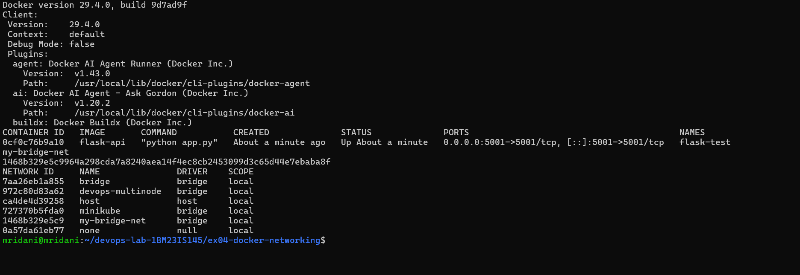

### Task 3: Inspect the network
#### Part 4 – Inspect the network
```bash
docker network inspect my-bridge-net
```
**Key output:**
```text
"Name": "my-bridge-net",
"Driver": "bridge",
"IPAM": { "Config": [ { "Subnet": "172.18.0.0/16", "Gateway": "172.18.0.1" } ] },
"Containers": {},
```
The network has its own subnet `172.18.0.0/16`; no containers are attached yet.

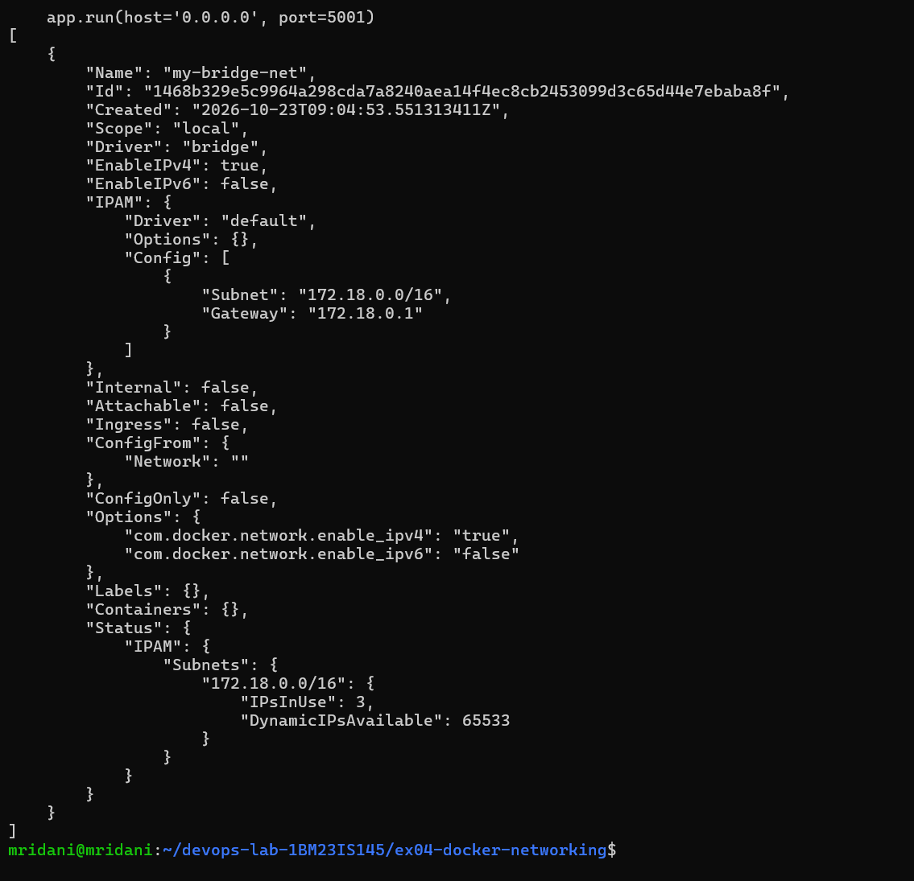

### Task 4: Launch containers
#### Part 5 – Create the Flask application
`app.py`:
```python
from flask import Flask, jsonify

app = Flask(__name__)

@app.route('/about', methods=['GET'])
def about():
    return jsonify({
        "name": "Simple REST API",
        "version": "1.0",
        "description": "This is a simple REST API built with Flask."
    })

if __name__ == '__main__':
    app.run(host='0.0.0.0', port=5001)
```
`host='0.0.0.0'` makes Flask listen on all interfaces inside the container instead of only `127.0.0.1`, so the published port can reach it.

#### Part 6 – Create `requirements.txt`
```text
Flask==2.0.1
Werkzeug==2.0.3
```
Werkzeug is pinned because Flask 2.0.1 fails with newer Werkzeug releases (Section 6).

#### Part 7 – Create the Dockerfile
```dockerfile
# Use the official Python image from the Docker Hub
FROM python:3.9-slim

# Set the working directory in the container
WORKDIR /app

# Copy the requirements file and app code to the container
COPY requirements.txt .
COPY app.py .

# Install Flask (and any other dependencies you might have)
RUN pip install --no-cache-dir -r requirements.txt

# Expose the port the app runs on
EXPOSE 5001

# Define the command to run the application
CMD ["python", "app.py"]
```

#### Part 8 – Build the Flask image
```bash
docker build -t flask-api .
docker images flask-api
```
**Output:**
```text
 => [5/5] RUN pip install --no-cache-dir -r requirements.txt
 => => naming to docker.io/library/flask-api:latest
IMAGE              ID             DISK USAGE   CONTENT SIZE
flask-api:latest   ef7d85a3bf6f        200MB         48.8MB
```
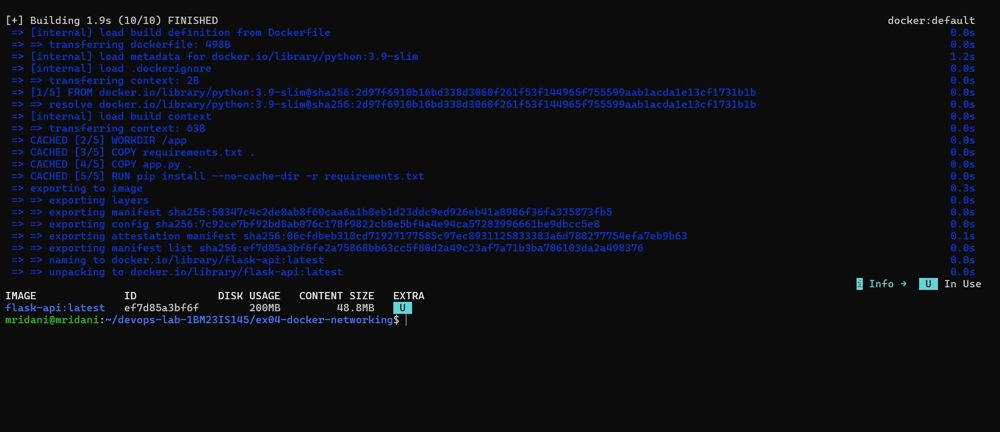

#### Part 9 – Test the Flask image independently
```bash
docker run -d --name flask-test -p 5001:5001 flask-api
docker ps
curl http://localhost:5001/about
```
**Output:**
```text
CONTAINER ID   IMAGE       COMMAND           STATUS         PORTS                    NAMES
0cf0c76b9a10   flask-api   "python app.py"   Up 3 seconds   0.0.0.0:5001->5001/tcp   flask-test
{"description":"This is a simple REST API built with Flask.","name":"Simple REST API","version":"1.0"}
```
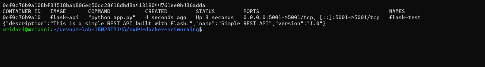

#### Part 10 – Start MySQL
#### Part 11 – Start Redis
```bash
docker run -d --name mysql --network my-bridge-net -e MYSQL_ROOT_PASSWORD=rootpass -e MYSQL_DATABASE=devopsdb mysql:latest
docker run -d --name redis --network my-bridge-net redis:latest
docker ps
```
**Output:**
```text
IMAGE          COMMAND                  STATUS         PORTS                    NAMES
redis:latest   "docker-entrypoint.s…"   Up 5 seconds   6379/tcp                 redis
mysql:latest   "docker-entrypoint.s…"   Up 6 seconds   3306/tcp, 33060/tcp      mysql
flask-api      "python app.py"          Up 4 minutes   0.0.0.0:5001->5001/tcp   flask-test
```
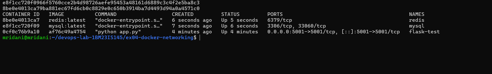

#### Part 12 – Verify the network
Containers attached to `my-bridge-net` (the `Containers` section of `docker network inspect`):
```bash
docker network inspect my-bridge-net --format '{{range .Containers}}{{.Name}}  {{.IPv4Address}}{{println}}{{end}}'
```
```text
redis  172.18.0.3/16
mysql  172.18.0.2/16
```
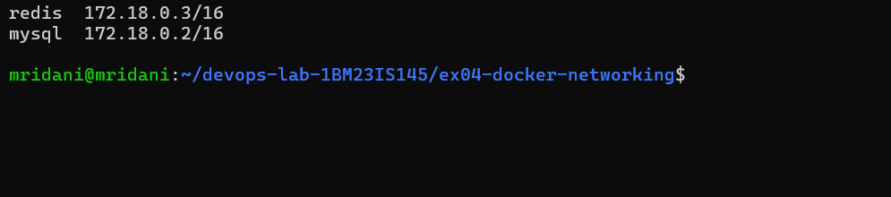

#### Part 13 – Start Flask on the same network
```bash
docker rm -f flask-test
docker run -d --name flask --network my-bridge-net -p 5001:5001 flask-api
docker ps
```
**Output:**
```text
IMAGE          COMMAND                  STATUS               PORTS                    NAMES
flask-api      "python app.py"          Up 3 seconds         0.0.0.0:5001->5001/tcp   flask
redis:latest   "docker-entrypoint.s…"   Up About a minute    6379/tcp                 redis
mysql:latest   "docker-entrypoint.s…"   Up About a minute    3306/tcp, 33060/tcp      mysql
```
Three containers: `flask`, `mysql` and `redis`.

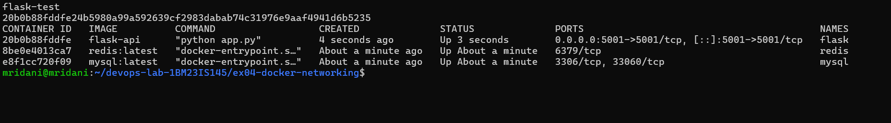

#### Part 14 – Understand `-p 5001:5001`
`-p HOST_PORT:CONTAINER_PORT` maps host port 5001 to container port 5001. Port publishing is only for access from outside the Docker network; Flask does not need published MySQL or Redis ports to reach them on the same network.

### Task 5: Test connectivity
#### Part 15 – Test the Flask API
```bash
curl http://localhost:5001/about
```
```text
{"description":"This is a simple REST API built with Flask.","name":"Simple REST API","version":"1.0"}
```
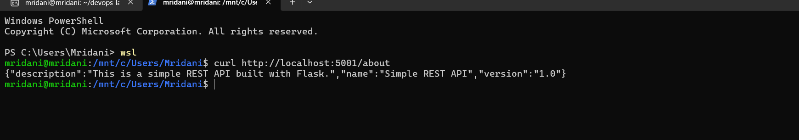

#### Part 16 – Enter the Flask container
#### Part 17 – Test DNS resolution
```bash
docker exec -it flask bash
```
`python:3.9-slim` has no `ping`, so it is installed inside the running container (apt sources switched to https first, because plain http is blocked on this network):
```bash
sed -i 's|http://|https://|g' /etc/apt/sources.list.d/debian.sources
apt-get update && apt-get install -y iputils-ping
ping -c 3 mysql
ping -c 3 redis
getent hosts mysql
getent hosts redis
```
**Output:**
```text
PING mysql (172.18.0.2) 56(84) bytes of data.
64 bytes from mysql.my-bridge-net (172.18.0.2): icmp_seq=1 ttl=64 time=0.677 ms
--- mysql ping statistics ---
3 packets transmitted, 3 received, 0% packet loss, time 2000ms
PING redis (172.18.0.3) 56(84) bytes of data.
64 bytes from redis.my-bridge-net (172.18.0.3): icmp_seq=1 ttl=64 time=0.199 ms
--- redis ping statistics ---
3 packets transmitted, 3 received, 0% packet loss, time 2000ms
172.18.0.2      mysql
172.18.0.3      redis
```
Docker's embedded DNS resolves the container names, so Flask reaches MySQL and Redis by name instead of hard-coded IPs.

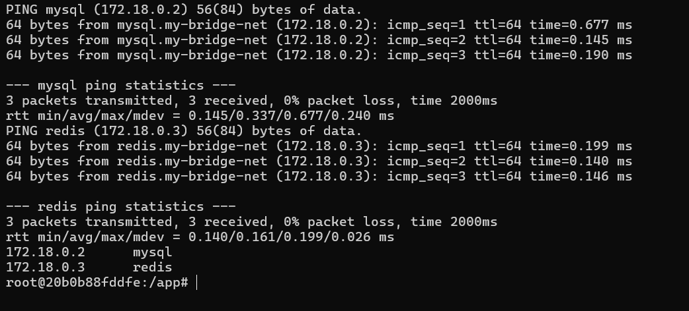

#### Part 18 – Test Redis
#### Part 19 – Test MySQL
```bash
docker exec -it redis redis-cli ping
docker exec -it mysql mysql -uroot -prootpass -e "SHOW DATABASES;"
```
**Output:**
```text
PONG
+--------------------+
| Database           |
+--------------------+
| devopsdb           |
| information_schema |
| mysql              |
| performance_schema |
| sys                |
+--------------------+
```
Redis answers `PONG`, and MySQL lists the `devopsdb` database created through `MYSQL_DATABASE`.

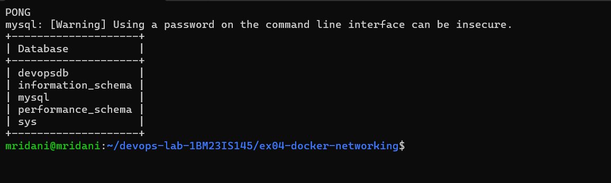

#### Part 20 – Final communication architecture
```text
Host ── localhost:5001 ──▶ flask (172.18.0.4)
                              │  my-bridge-net
                    ┌─────────┴─────────┐
                    ▼                   ▼
             mysql (172.18.0.2)   redis (172.18.0.3)
```
Host → Flask uses the published port; Flask → MySQL and Flask → Redis use the internal network and container names.

#### Part 21 – Verify everything
```bash
docker ps
docker network inspect my-bridge-net --format '{{range .Containers}}{{.Name}}  {{.IPv4Address}}{{println}}{{end}}'
docker port flask
curl http://localhost:5001/about
docker exec flask getent hosts mysql
docker exec flask getent hosts redis
```
**Output:**
```text
flask  172.18.0.4/16
redis  172.18.0.3/16
mysql  172.18.0.2/16
5001/tcp -> 0.0.0.0:5001
5001/tcp -> [::]:5001
{"description":"This is a simple REST API built with Flask.","name":"Simple REST API","version":"1.0"}
172.18.0.2      mysql
172.18.0.3      redis
```
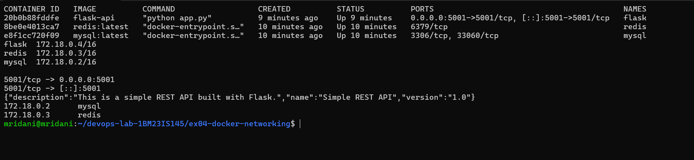

#### Part 24 – Final verification checklist
| # | Check | Result |
|---|---|---|
| 1 | Docker works | ✅ Part 1 |
| 2 | Network created | ✅ Part 3 |
| 3 | Network inspected | ✅ Part 4 |
| 4 | Flask image built | ✅ Part 8 |
| 5 | Three containers running | ✅ Part 13 |
| 6 | All containers on the same network | ✅ Part 21 |
| 7 | Flask exposed to host (`curl /about`) | ✅ Parts 15, 21 |
| 8 | MySQL DNS resolution | ✅ `172.18.0.2 mysql` |
| 9 | Redis DNS resolution | ✅ `172.18.0.3 redis` |
| 10 | Cleanup complete | ✅ Parts 25–26 |

### Task 6: Clean up
#### Part 25 – Clean up containers
#### Part 26 – Remove the network
```bash
docker stop mysql redis flask
docker rm mysql redis flask
docker ps -a --filter "name=mysql" --filter "name=redis" --filter "name=flask"
docker network rm my-bridge-net
docker network ls
```
The three containers are gone and `my-bridge-net` no longer appears in `docker network ls`.

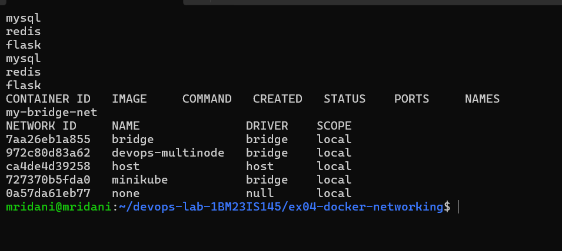

## 6. Why the short manual page's version fails
The manual page's original files (kept in `manual-original/`) were built and run exactly as written:

| Manual page | What happened | Fixed by (walkthrough) |
|---|---|---|
| `docker build` with the manual page's Dockerfile | Builds successfully | – |
| `docker run -d --name mysql --net=my-bridge-net mysql:latest` | MySQL exits: `Database is uninitialized and password option is not specified` | `MYSQL_ROOT_PASSWORD` (Part 10) |
| Flask container with only `Flask==2.0.1` | Exits: `ImportError: cannot import name 'url_quote' from 'werkzeug.urls'` | `Werkzeug==2.0.3` (Part 6) |
| `ping mysql` in the Flask image | `exec: "ping": executable file not found in $PATH` | Install `iputils-ping` in the container (Part 17) |

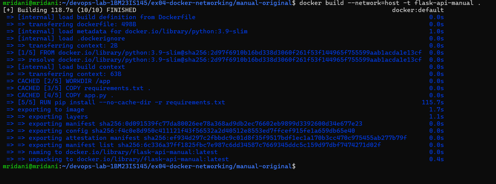
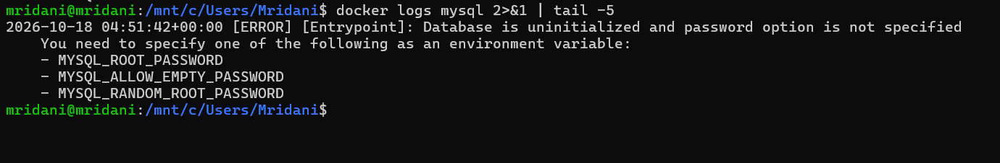
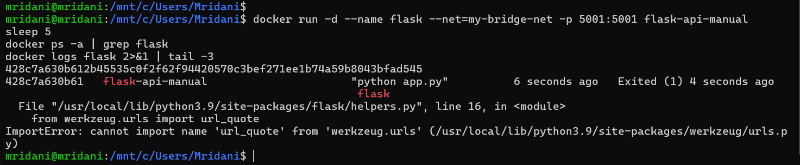
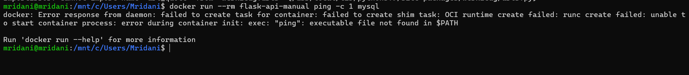

## 7. Questions (manual page and walkthrough Part 22)
1. **What is the purpose of `--net`?** It specifies the Docker network a container connects to; the modern form is `--network`.
2. **How do containers communicate on the same network?** By container name or IP address. Names are preferred because IPs can change when containers are recreated – here `mysql` → `172.18.0.2`, `redis` → `172.18.0.3`.
3. **Bridge vs host networking?** A bridge network gives each container its own network namespace connected through Docker networking; host networking shares the host's network stack directly.
4. **How do you expose a container port?** With `-p HOST_PORT:CONTAINER_PORT`, e.g. `docker run -p 5001:5001 flask-api`.

## 8. Result
Flask, MySQL and Redis ran on the user-defined bridge network `my-bridge-net`. The Flask API was reachable from the host through the published port 5001, Flask resolved and reached `mysql` and `redis` by name with 0% packet loss, Redis answered `PONG` and MySQL showed the `devopsdb` database – every item of the walkthrough's final checklist.
