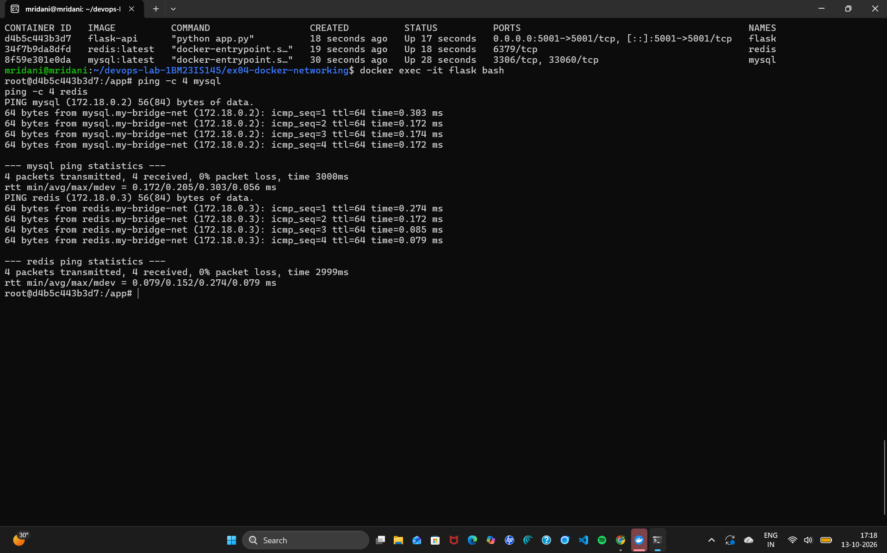
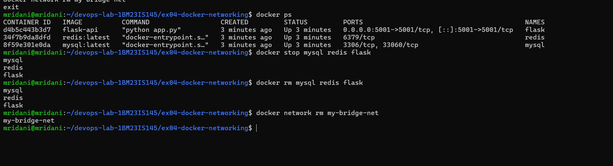

# Exercise 4: Docker Networking with Multiple Containers

## Aim
Configure a multi-container application (Flask + MySQL + Redis) on a user-defined Docker bridge network and verify that containers communicate using container names.

## Files
- `app.py` – Flask REST API (`/about` endpoint)
- `requirements.txt` – Python dependencies
- `Dockerfile` – builds the `flask-api` image

## Steps
1. Build image: `docker build -t flask-api .`
2. Create network: `docker network create --driver bridge my-bridge-net`
3. Verify and inspect: `docker network ls`, `docker network inspect my-bridge-net`
4. Run containers on the network:
   - `docker run -d --name mysql --net=my-bridge-net -e MYSQL_ROOT_PASSWORD=root mysql:latest`
   - `docker run -d --name redis --net=my-bridge-net redis:latest`
   - `docker run -d --name flask --net=my-bridge-net -p 5001:5001 flask-api`
5. Verify: `docker ps` and browser at `http://localhost:5001/about`
6. Test connectivity: `docker exec -it flask bash`, then `ping -c 4 mysql` and `ping -c 4 redis`
7. Clean up: stop/remove containers and remove the network

## Fixes made to the manual's version
| Issue | Effect | Fix |
|---|---|---|
| MySQL run without a root password | MySQL container exits immediately | Added `-e MYSQL_ROOT_PASSWORD=root` |
| Flask bound to 127.0.0.1 (default) | API not reachable from host | `app.run(host="0.0.0.0", ...)` |
| Flask 2.0.1 with newer Werkzeug | ImportError on startup | Pinned `Werkzeug==2.0.3` |
| `python:3.9-slim` has no `ping` | `ping: command not found` | Installed `iputils-ping` in Dockerfile |

## Screenshots
1. Build and network: 
2. Containers running and ping test: 
3. Flask API in browser: 
4. Cleanup: 

## Questions
1. **Purpose of `--net`?** Connects the container to a specific Docker network.
2. **How do containers on the same network communicate?** Docker's built-in DNS resolves container names to their IPs on user-defined networks, so containers reach each other by name.
3. **Bridge vs host network?** Bridge gives containers an isolated private network with their own IPs; host shares the host machine's network stack directly, with no isolation.
4. **Exposing a port to the host?** Use `-p host_port:container_port`, e.g. `-p 5001:5001`.

## Result
Successfully configured Docker bridge networking for a multi-container application and verified inter-container communication by container name (0% packet loss to `mysql` and `redis`).
