# Exercise 5: Docker Security with AppArmor and Python

## 1. Aim
Secure a containerized Python Flask application with an AppArmor profile that restricts access to sensitive directories and prevents certain actions, apply the profile with the Docker CLI and with the Docker SDK for Python, and test whether the restricted actions are blocked.

## 2. Environment
| Component | Details |
|---|---|
| Operating system | Windows 11 + WSL2 (Ubuntu 24.04) |
| Container platform | Docker Desktop |
| Python | Docker SDK for Python (`docker` package) in a virtual environment |

**Important limitation:** the WSL2 kernel has AppArmor **disabled** (`/sys/module/apparmor/parameters/enabled` returns `N`, and `docker info` lists only `seccomp` and `cgroupns` under Security Options). All steps of the manual were run, and the results below show exactly where this matters.

## 3. Files in this folder
| File | Purpose |
|---|---|
| `app.py` | Flask application – identical to the manual |
| `Dockerfile` | Builds the `flask-apparmor` image – identical to the manual |
| `my-apparmor-profile` | AppArmor profile – identical to the manual |
| `apply_apparmor.py` | Docker SDK script that runs the container with the profile – identical to the manual |
| `test_restricted_actions.py` | Docker SDK script that tests restricted actions – identical to the manual |
| `apply_apparmor_extended.py`, `test_restricted_actions_extended.py` | Extended versions that also print the *enforced* profile (`AppArmorProfile`) and remove the containers afterwards |

## 4. Pre-requisites
```bash
sudo apt-get update
sudo apt-get install apparmor-utils
```

## 5. Tasks (in the order of the manual)

### Task 1: Write a basic Python Flask application
`app.py`:
```python
from flask import Flask

app = Flask(__name__)

@app.route('/')
def home():
    return "Hello, this is a secure Flask application running inside a Docker container!"

if __name__ == '__main__':
    app.run(host='0.0.0.0', port=5000)
```

### Task 2: Containerize the Flask application using a Dockerfile
`Dockerfile`:
```dockerfile
# Use an official Python runtime as a parent image
FROM python:3.8-slim

# Set the working directory in the container
WORKDIR /app

# Copy the current directory contents into the container at /app
COPY . /app

# Install Flask
RUN pip install flask

# Expose port 5000
EXPOSE 5000

# Run app.py when the container launches
CMD ["python", "app.py"]
```
**Build the Docker image:**
```bash
docker build -t flask-apparmor .
```
(`--network=host` was added on this machine only because the default build network was slow.)
```text
[+] Building 181.9s (9/9) FINISHED
 => [4/4] RUN pip install flask
 => => naming to docker.io/library/flask-apparmor:latest
```
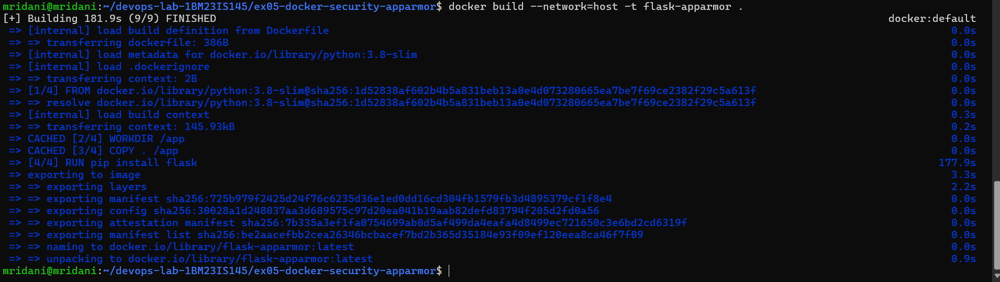

**Run the container and check the app:**
```bash
docker run -d --name flask-secure -p 5000:5000 flask-apparmor
docker ps
```
```text
IMAGE            COMMAND           STATUS          PORTS                    NAMES
flask-apparmor   "python app.py"   Up 26 seconds   0.0.0.0:5000->5000/tcp   flask-secure
```
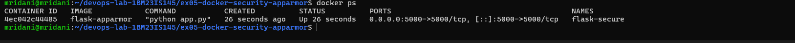

`http://localhost:5000` shows the app's message:

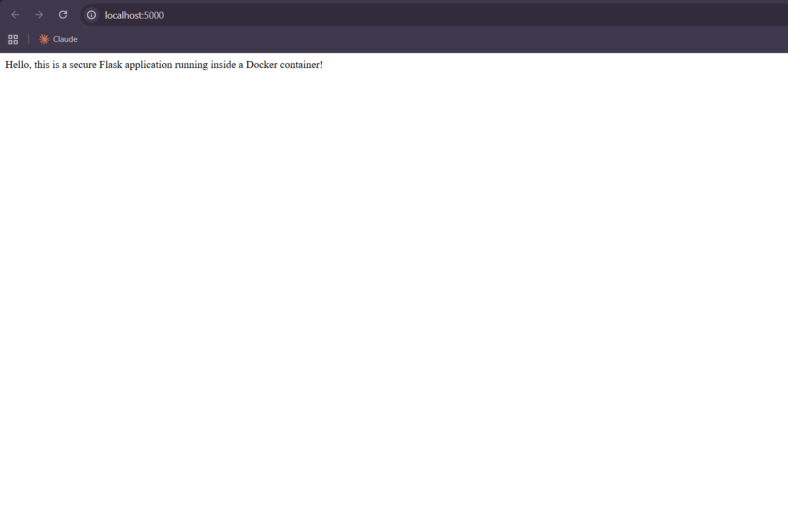

### Task 3: Create and apply the AppArmor profile
`my-apparmor-profile`, saved as `/etc/apparmor.d/my-apparmor-profile`:
```text
#include <tunables/global>

/usr/bin/python3 {
    # Deny access to sensitive system files
    deny /etc/** r,
    deny /var/** rw,

    # Allow Flask app to bind to port 5000
    network inet stream,

    # Permissions to the application directory
    /app/** rwk,

    # Deny execution of any binaries in /bin or /usr/bin
    deny /bin/** rmix,
    deny /usr/bin/** rmix,

    # Capability restrictions
    capability net_bind_service,
    deny capability sys_admin,
}
```
**b. Load the profile:**
```bash
sudo apparmor_parser -r /etc/apparmor.d/my-apparmor-profile
```
```text
Cache read/write disabled: interface file missing. (Kernel needs AppArmor 2.4 compatibility patch.)
Warning: unable to find a suitable fs in /proc/mounts, is it mounted?
```
The profile cannot be loaded, because the WSL2 kernel has AppArmor disabled.

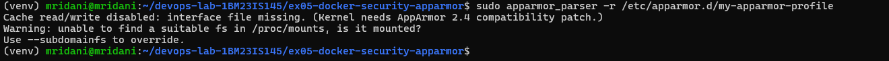

**c. Run the Docker container with the profile** – the manual's command, run exactly as written:
```bash
docker run --security-opt="apparmor=my-apparmor-profile" -p 5000:5000 flask-apparmor
```
```text
 * Serving Flask app 'app'
 * Debug mode: off
 * Running on all addresses (0.0.0.0)
 * Running on http://127.0.0.1:5000
 * Running on http://172.17.0.2:5000
Press CTRL+C to quit
```
Docker starts the container without any error about the profile:

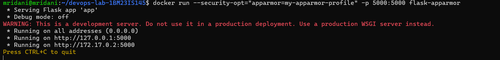

The app is reachable at `http://localhost:5000`:

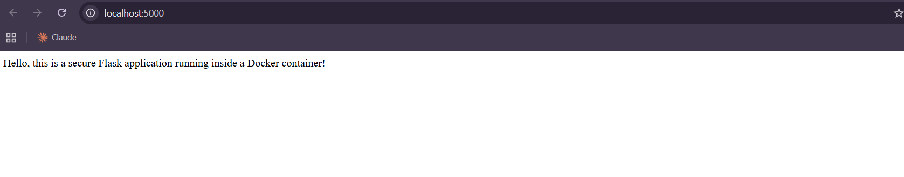

To check whether the profile is actually enforced, the same container was started in the background with a name, inspected, and a denied action was tried:
```bash
docker run -d --name flask-secure --security-opt="apparmor=my-apparmor-profile" -p 5000:5000 flask-apparmor
docker inspect flask-secure --format 'SecurityOpt={{.HostConfig.SecurityOpt}}  AppArmorProfile={{.AppArmorProfile}}'
docker exec flask-secure cat /etc/passwd
```
```text
SecurityOpt=[apparmor=my-apparmor-profile]  AppArmorProfile=
root:x:0:0:root:/root:/bin/bash
daemon:x:1:1:daemon:/usr/sbin:/usr/sbin/nologin
...
```
Docker **accepts** the option and records it in `SecurityOpt`, but the enforced profile (`AppArmorProfile`) is **empty**, and `/etc/passwd` can still be read.

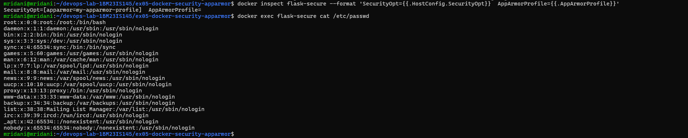

### Task 4: Use the Docker SDK for Python to apply the AppArmor profile
`pip install docker` is blocked on Ubuntu 24.04 (`externally-managed-environment`), so a virtual environment is used:
```bash
python3 -m venv venv
source venv/bin/activate
pip install docker
python apply_apparmor.py
```
**Output (the manual's unmodified script):**
```text
Container started: 4f469c9fd463
AppArmor profile applied: ['apparmor=my-apparmor-profile']
```
This is the output the manual expects: the script builds the image, runs the container with the profile and reads `HostConfig.SecurityOpt`.

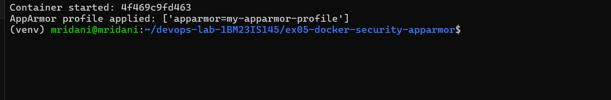

The extended script additionally prints the *enforced* profile, which confirms that it is empty on WSL2:

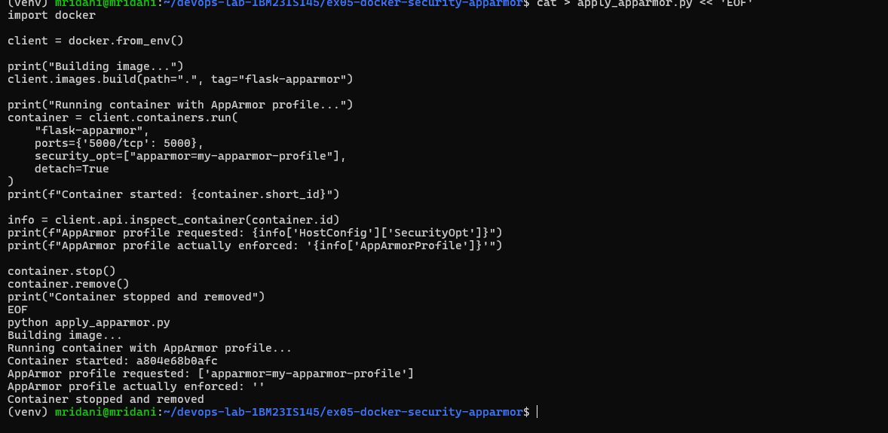

### Task 5: Test restricted actions
```bash
python test_restricted_actions.py
```
**Output (the manual's unmodified script):**
```text
Attempt to read /etc/passwd: Exit Code 0, Output: root:x:0:0:root:/root:/bin/bash
daemon:x:1:1:daemon:/usr/sbin:/usr/sbin/nologin
...
Attempt to execute /bin/bash: Exit Code 0, Output:
```
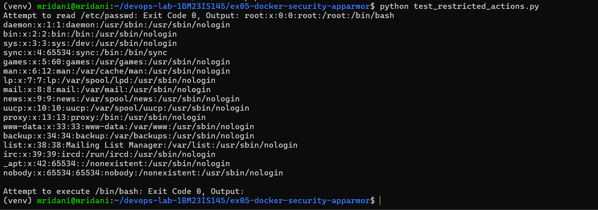

The extended test gives the same result:

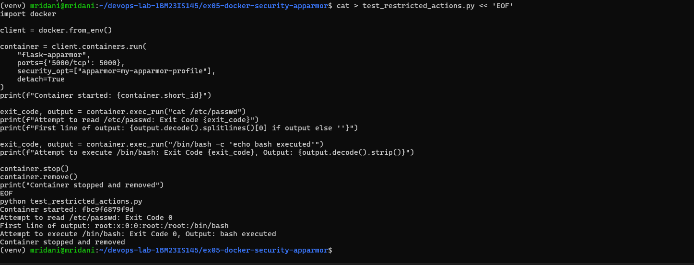

## 6. Expected vs observed
| Check | Expected (manual) | Observed on WSL2 |
|---|---|---|
| `apparmor_parser -r` | Profile loads | Fails: "Kernel needs AppArmor 2.4 compatibility patch" |
| `docker inspect` | Profile applied | `SecurityOpt=[apparmor=my-apparmor-profile]`, `AppArmorProfile=` (empty) |
| `apply_apparmor.py` | `AppArmor profile applied: [...]` | Same – `['apparmor=my-apparmor-profile']` |
| Read `/etc/passwd` | Exit code 1 (blocked) | Exit code 0, file printed |
| Execute `/bin/bash` | Exit code 126 (blocked) | Exit code 0 |

**Why:** AppArmor is a Linux kernel security module, and the WSL2 kernel ships with it disabled. Docker therefore accepts `--security-opt apparmor=...` without any error but silently does not enforce it. The lesson: a requested security option is not proof of enforcement – it has to be verified with `docker inspect` (`AppArmorProfile`) and by actually testing a denied action. On a native Linux host with AppArmor enabled, the same files and commands should block both actions.

**Note:** the manual's profile is attached to `/usr/bin/python3`, but `python:3.8-slim` runs `/usr/local/bin/python`. With `--security-opt` the profile is attached to the whole container, so this path does not matter for Docker.

## 7. Questions
1. **What is the purpose of using AppArmor with Docker containers?** It enforces mandatory access control, confining a container to a limited set of files, capabilities and network access – a security layer beyond Docker's default isolation.
2. **How do AppArmor profiles help secure a Docker container?** They define what the containerized process can read, write and execute and which capabilities it can use; anything denied is blocked by the kernel.
3. **Why restrict access to `/etc/` and `/var/`?** They hold configuration files, user account data and logs; restricting them prevents a compromised container from reading sensitive data or tampering with the system.
4. **What other capabilities can be restricted?** Network access, binding to ports, executing binaries, writing to directories, mounting filesystems, and Linux capabilities such as `sys_admin`.
5. **How can you verify that a profile is applied?** Inspect the container (`HostConfig.SecurityOpt` shows the requested profile, `AppArmorProfile` the enforced one), check `docker info` for `apparmor` under Security Options, and test a denied action.

## 8. Result
The Flask app was containerized, the AppArmor profile was written and applied with both the Docker CLI and the Docker SDK (the manual's `apply_apparmor.py` ran as expected), and the restricted actions were tested. Because the WSL2 kernel has AppArmor disabled, the profile was accepted but not enforced; this was verified and documented.
