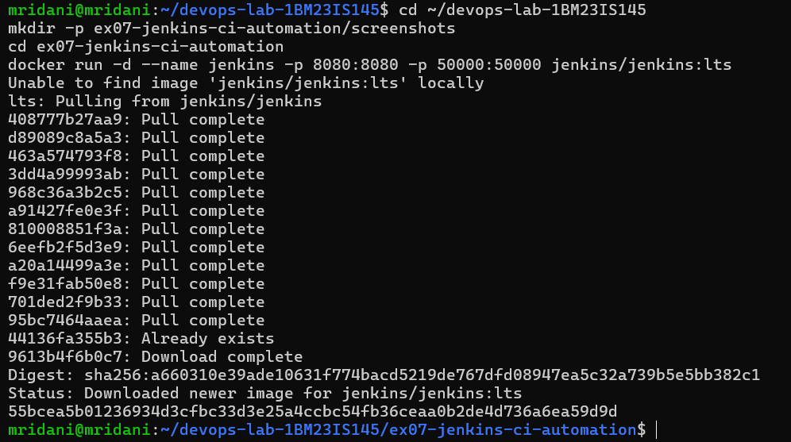
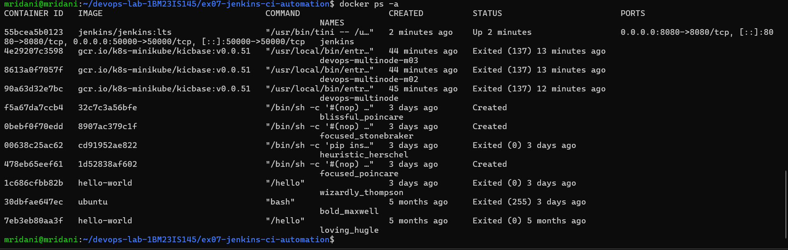
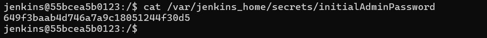
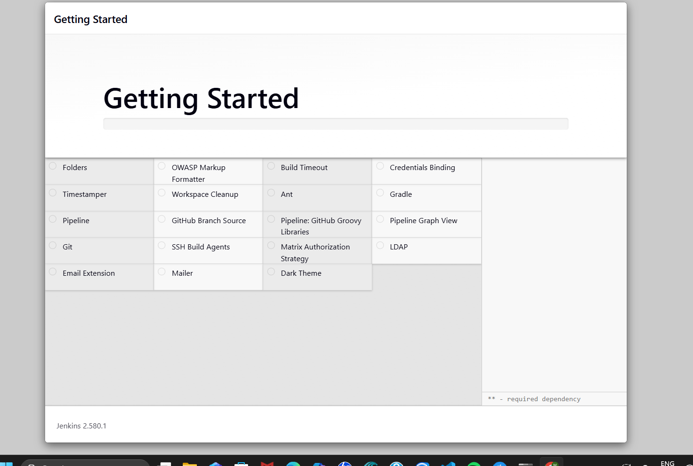
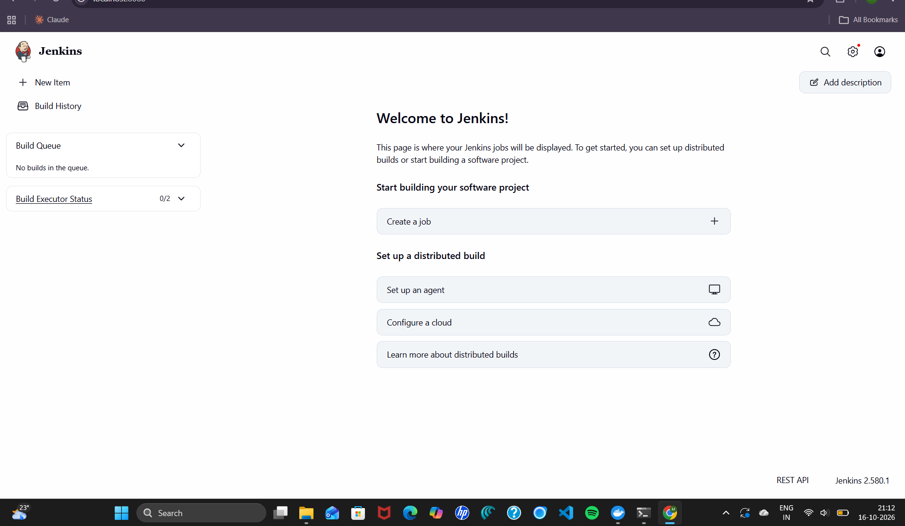
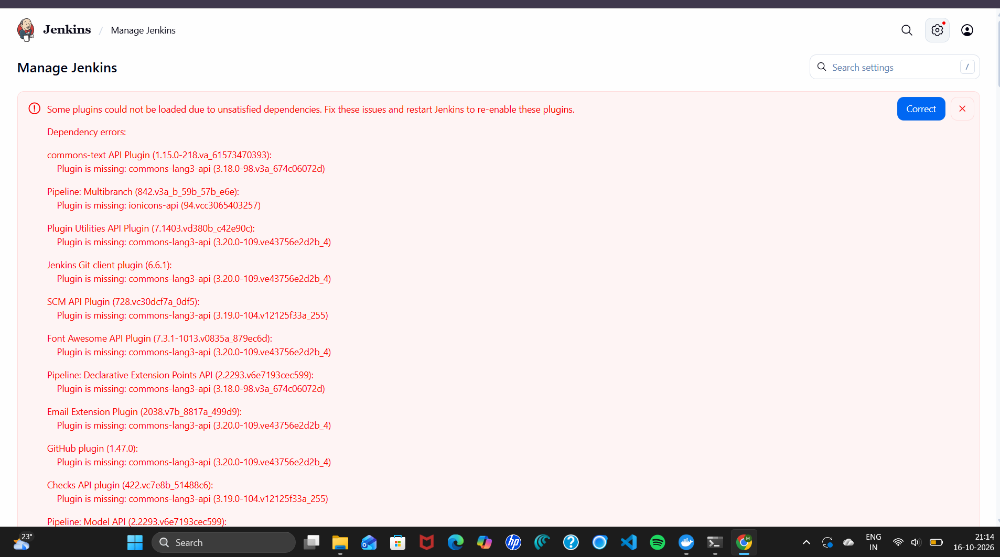
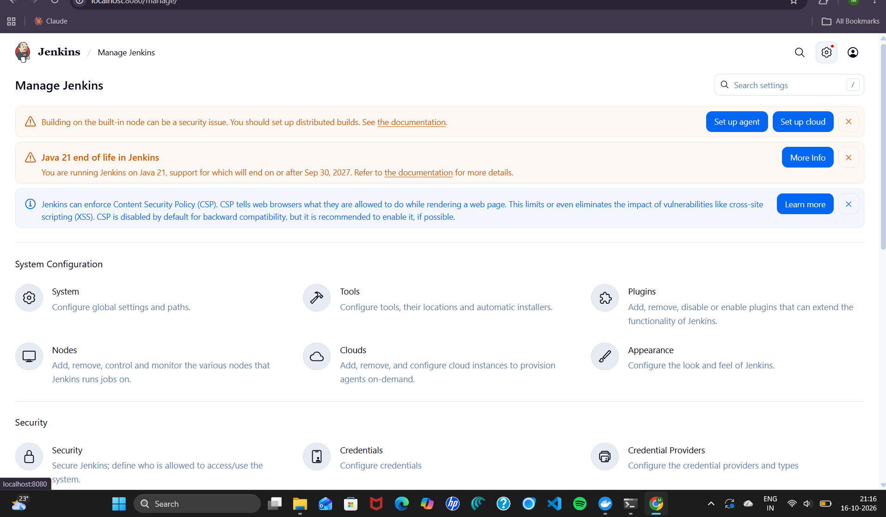
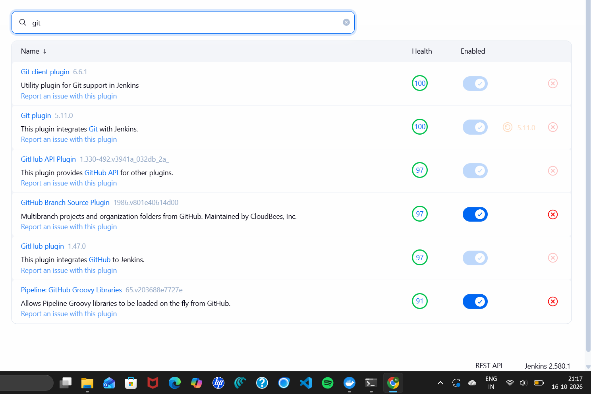

# Exercise 7: Introduction to CI and Jenkins Installation

## Aim
Understand Continuous Integration (CI) and install Jenkins using Docker, unlock it, install the suggested plugins and reach the Jenkins dashboard.

## Environment
Windows 11 + WSL2 (Ubuntu 24.04) + Docker Desktop, Jenkins 2.580.1 (`jenkins/jenkins:lts`)

## Steps (as per the manual)
1. Run Jenkins: `docker run -d --name jenkins -p 8080:8080 -p 50000:50000 jenkins/jenkins:lts`
2. Verify: `docker ps -a` (jenkins is `Up`, ports 8080 and 50000 mapped)
3. Get the initial admin password: `docker exec -it jenkins bash`, then `cat /var/jenkins_home/secrets/initialAdminPassword`
4. Open `http://localhost:8080`, unlock with the password
5. Install suggested plugins, create the first admin user, Save and Finish

## Issue faced and fix
During "Install suggested plugins", the downloads of `commons-lang3-api` and `ionicons-api` failed (unstable network from the Docker container). Because many plugins depend on them (Git client, Pipeline, SCM API, GitHub, ...), Manage Jenkins showed **"Some plugins could not be loaded due to unsatisfied dependencies"**. Fixed by clicking **Correct** (Jenkins downloaded the missing dependencies) and restarting with `docker restart jenkins`. Afterwards the error was gone and the Git plugin showed health 100.

## Screenshots
1. Jenkins container started: 
2. Container running: 
3. Initial admin password: 
4. Installing suggested plugins: 
5. Jenkins dashboard: 
6. Plugin dependency errors: 
7. Errors fixed after Correct + restart: 
8. Git plugins installed and healthy: 

## Key Concepts
- **Continuous Integration:** developers merge code into a shared repository frequently; every change triggers an automated build and tests, giving early feedback and catching integration bugs early.
- **Jenkins:** open-source automation server for building, testing and deploying software; extended through plugins.
- **Job/Project:** a task Jenkins runs. **Build:** one run of a job. **Pipeline:** a series of stages (build, test, deploy). **Plugins:** add features (e.g. Git). **Nodes:** machines that run jobs (built-in node / agents).
- **Ports:** 8080 = web UI, 50000 = agent connections.
- Other CI tools: GitLab CI/CD, CircleCI, Travis CI, Bamboo, TeamCity, Azure Pipelines, GitHub Actions, Spinnaker, Buildkite, Drone.

## Result
Jenkins was installed in Docker, unlocked and configured with the suggested plugins, and is ready for creating jobs and pipelines.
