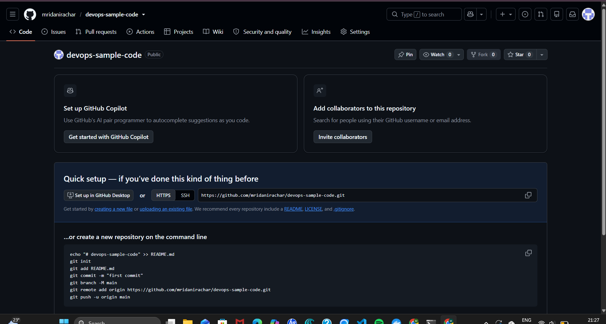
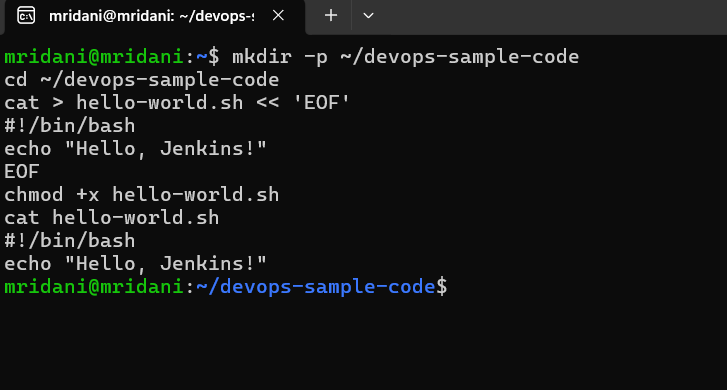
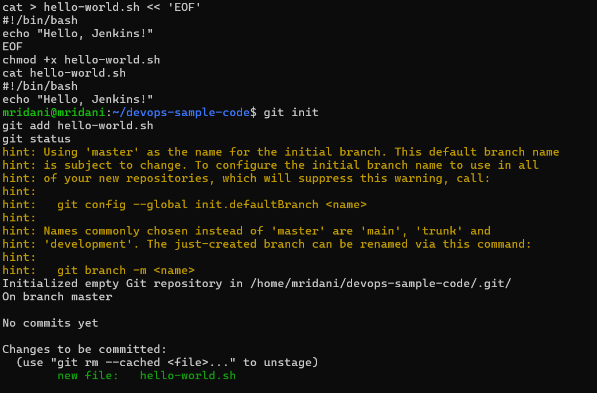
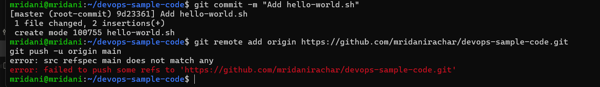
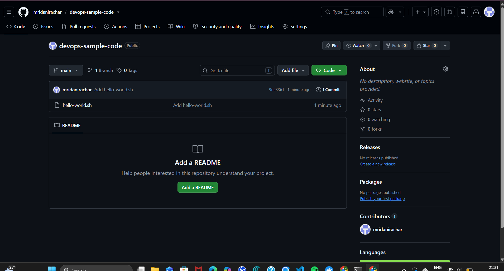
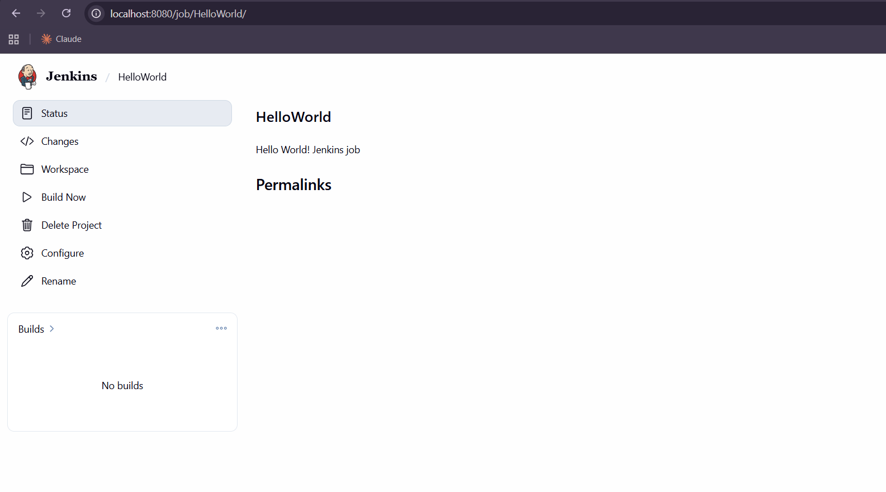
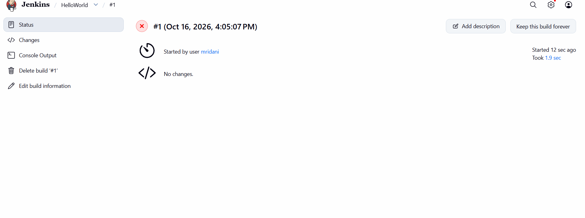
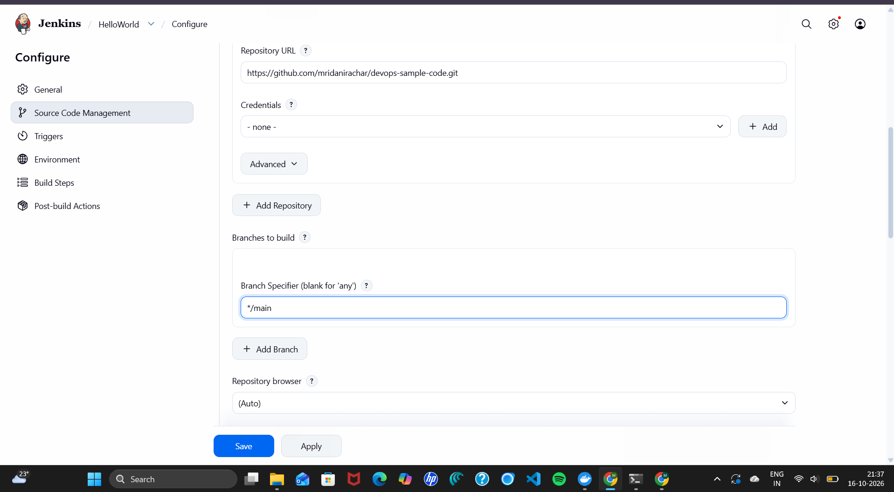
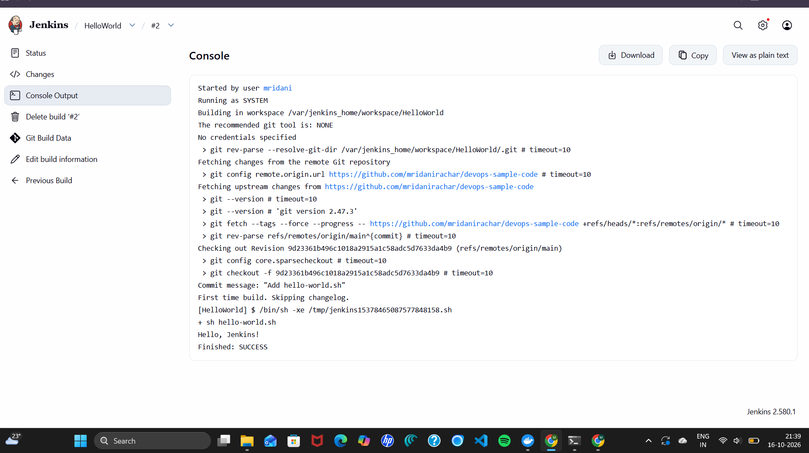

# Exercise 8: Creating a "Hello World" Jenkins Job

## 1. Aim
Store a shell script (`hello-world.sh`) in a GitHub repository and create a Jenkins Freestyle job that pulls the script from GitHub and runs it.

## 2. Environment
| Component | Details |
|---|---|
| Operating system | Windows 11 + WSL2 (Ubuntu 24.04) |
| Git | 2.43 |
| Jenkins | 2.580.1 in Docker (installed in Exercise 7) |
| Repository | https://github.com/mridanirachar/devops-sample-code |

## 3. Files in this folder
| File | Purpose |
|---|---|
| `hello-world.sh` | Copy of the script stored in `devops-sample-code` – identical to the manual |

## 4. Steps (in the order of the manual)

### Step 1: Create the file `hello-world.sh` in your GitHub account

#### (1a) Create a new GitHub repository
Repository name **devops-sample-code**, description *"A demo repository for Jenkins scripting."*, visibility **Public**:



#### (1b) Personal access token
A personal access token is needed to push over HTTPS. The existing classic token (repo scope) was used instead of creating a new fine-grained one; both work for pushing to this repository.

#### (2) Create the script locally
```bash
touch hello-world.sh
```
Content (identical to the manual):
```bash
#!/bin/bash
echo "Hello, Jenkins!"
```
```bash
chmod +x hello-world.sh
```


#### (3) Initialize a local Git repository
#### (4) Add the script to the repository
Git was already configured with the author's name and e-mail (`git config --global user.name ...`, `git config --global user.email ...`), so only `git init` was needed:
```bash
git init
git add hello-world.sh
git status
```
**Output:**
```text
Initialized empty Git repository in /home/mridani/devops-sample-code/.git/
On branch master

No commits yet

Changes to be committed:
  (use "git rm --cached <file>..." to unstage)
        new file:   hello-world.sh
```


```bash
git commit -m "Add hello-world.sh"
```
```text
[master (root-commit) 9d23361] Add hello-world.sh
 1 file changed, 2 insertions(+)
 create mode 100755 hello-world.sh
```

#### (5) Link the local repository to GitHub
#### (6) Push the script to GitHub
**Manual commands, run exactly as written:**
```bash
git remote add origin https://github.com/mridanirachar/devops-sample-code.git
git push -u origin main
```
```text
error: src refspec main does not match any
error: failed to push some refs to 'https://github.com/mridanirachar/devops-sample-code.git'
```
`git init` created the branch `master` (exactly as in the manual's own output), but the manual pushes `main`.



The branch was renamed and pushed:
```bash
git branch -M main
git push -u origin main
```

#### (7) Verify the script on GitHub
`hello-world.sh` is on the `main` branch of `devops-sample-code`:



### Step 1: Access Jenkins
Open `http://localhost:8080` and log in.

### Step 2: Create a new job
New Item → name `HelloWorld` → **Freestyle project** → OK.



### Step 3: Configure the job
- **Description:** `Hello World! Jenkins job.`
- **Source Code Management:** Git, repository URL `https://github.com/mridanirachar/devops-sample-code`
- **Build Steps:** Add build step → Execute shell:
```bash
sh hello-world.sh
```

### Step 4: Save and run the job
Save → **Build Now**.

**Build #1 fails:** Jenkins' default *Branch Specifier* is `*/master`, but the repository's branch is `main`, so Jenkins reports `Couldn't find any revision to build`:



The Branch Specifier was changed to `*/main`:



### Step 5: View the build output
Build History → **#2** → Console Output:
```text
Started by user mridani
Building in workspace /var/jenkins_home/workspace/HelloWorld
 > git fetch --tags --force --progress -- https://github.com/mridanirachar/devops-sample-code +refs/heads/*:refs/remotes/origin/* # timeout=10
Checking out Revision 9d23361b496c1018a2915a1c58adc5d7633da4b9 (refs/remotes/origin/main)
Commit message: "Add hello-world.sh"
[HelloWorld] $ /bin/sh -xe /tmp/jenkins15378465087577848158.sh
+ sh hello-world.sh
Hello, Jenkins!
Finished: SUCCESS
```


## 5. Changes from the manual
| Manual | What happened | What was done |
|---|---|---|
| `git push -u origin main` after `git init` | `error: src refspec main does not match any` (the local branch is `master`) | `git branch -M main`, then push |
| Jenkins default Branch Specifier `*/master` | Build #1: `Couldn't find any revision to build` → FAILURE | Branch Specifier set to `*/main` |
| (1b) Create a fine-grained token | – | Existing classic token (repo scope) used |

## 6. Result
Jenkins cloned `devops-sample-code` from GitHub, ran `hello-world.sh` and printed **`Hello, Jenkins!`** with **`Finished: SUCCESS`** – the manual's expected console output.
