# Exercise 9: Jenkins Multi-Stage Pipeline – Deploying a Python Application

## 1. Objective
Create and run a Jenkins **Pipeline** with multiple stages – **Build**, **Test**, **Deploy**, **Run Application** and **Test Application** – for a sample Python Flask application, to understand how multi-stage CI/CD pipelines are implemented in Jenkins.

## 2. Scenario (from the manual)
Automate the CI/CD pipeline for a Python Flask application:
1. **Build** – install dependencies
2. **Test** – run unit tests to ensure the application works as expected
3. **Deploy** – copy the application to a mock deployment directory

## 3. Environment
| Component | Details |
|---|---|
| Operating system | Windows 11 + WSL2 (Ubuntu 24.04) |
| Jenkins | 2.580.1 in Docker (Debian trixie), from Exercise 7 |
| Python in Jenkins | 3.13.5, Flask 3.1.1 |
| Repository | https://github.com/mridanirachar/devops-sample-code |

## 4. Files in this folder
Copies of the files in `devops-sample-code` – all four identical to the manual:

| File | Purpose |
|---|---|
| `app.py` | Flask app returning `Hello, Jenkins Multi-Stage Pipeline!` |
| `requirements.txt` | `flask==2.1.2` |
| `test_app.py` | unittest for the `/` route |
| `Jenkinsfile` | Declarative pipeline with 5 stages and post actions |

## 5. Steps (in the order of the manual)

### Step 1: Set up Jenkins
Jenkins from Exercise 7 is used; the Pipeline plugin is part of the suggested plugins.

### Step 2: Create a sample Python application
`app.py`:
```python
from flask import Flask

app = Flask(__name__)

@app.route("/")
def home():
    return "Hello, Jenkins Multi-Stage Pipeline!"

if __name__ == "__main__":
    app.run(debug=True)
```
`requirements.txt`:
```text
flask==2.1.2
```
`test_app.py`:
```python
import unittest
from app import app

class TestApp(unittest.TestCase):
    def test_home(self):
        tester = app.test_client()
        response = tester.get("/")
        print(response.data.decode("utf-8"))
        self.assertEqual(response.status_code, 200)
        self.assertEqual(response.data.decode("utf-8"), "Hello, Jenkins Multi-Stage Pipeline!")

if __name__ == "__main__":
    unittest.main()
```
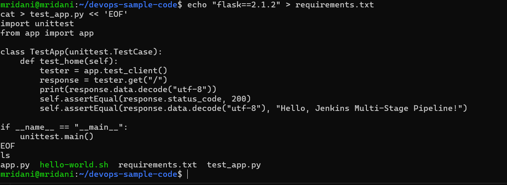

### Step 3: Push the application to a Git repository
The manual creates a new folder and runs `git init`, then pushes to `devops-sample-code`. That repository already contains the Exercise 8 commit, so a push from a fresh `git init` would be rejected; the files were therefore added to the existing local clone of `devops-sample-code`:
```bash
git add .
git commit -m "Initial commit"
git push
```
**Output:**
```text
[main 716dd50] Initial commit
 3 files changed, 24 insertions(+)
 create mode 100644 app.py
 create mode 100644 requirements.txt
 create mode 100644 test_app.py
To https://github.com/mridanirachar/devops-sample-code.git
   9d23361..716dd50  main -> main
```
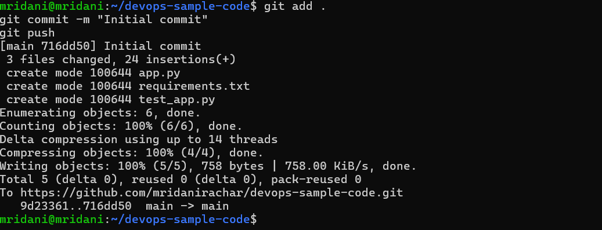

### Step 4: Create a multi-stage Jenkins pipeline
Jenkins → New Item → name `Python-MultiStage-Pipeline` → **Pipeline** → OK.

### Step 5: Define the Jenkinsfile
`Jenkinsfile` (identical to the manual):
```groovy
pipeline {
    agent any

    stages {
        stage('Build') {
            steps {
                echo 'Creating virtual environment and installing dependencies...'
            }
        }
        stage('Test') {
            steps {
                echo 'Running tests...'
                sh 'python3 -m unittest discover -s .'
            }
        }
        stage('Deploy') {
            steps {
                echo 'Deploying application...'
                sh '''
                mkdir -p ${WORKSPACE}/python-app-deploy
                cp ${WORKSPACE}/app.py ${WORKSPACE}/python-app-deploy/
                '''
            }
        }
        stage('Run Application') {
            steps {
                echo 'Running application...'
                sh '''
                nohup python3 ${WORKSPACE}/python-app-deploy/app.py > ${WORKSPACE}/python-app-deploy/app.log 2>&1 &
                echo $! > ${WORKSPACE}/python-app-deploy/app.pid
                '''
            }
        }
        stage('Test Application') {
            steps {
                echo 'Testing application...'
                sh '''
                python3 ${WORKSPACE}/test_app.py
                '''
            }
        }
    }

    post {
        success {
            echo 'Pipeline completed successfully!'
        }
        failure {
            echo 'Pipeline failed. Check the logs for more details.'
        }
    }
}
```
The Jenkinsfile was committed and pushed to `devops-sample-code` (`git add Jenkinsfile`, `git commit`, `git push`), so Jenkins can read it from the repository.

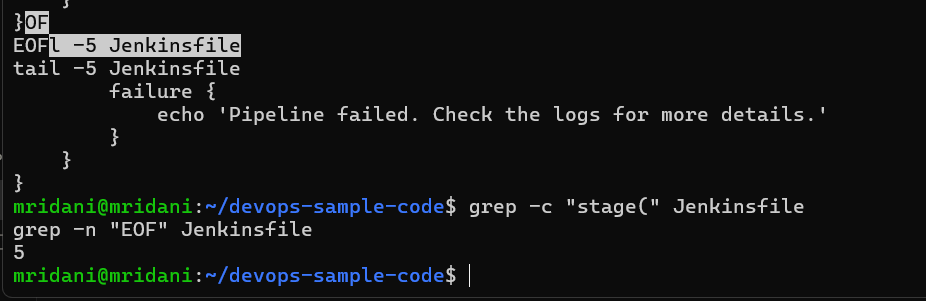

### Step 6: Configure the Jenkins job
Pipeline → Definition: **Pipeline script from SCM** → SCM: **Git** → repository URL `https://github.com/mridanirachar/devops-sample-code`. The Branch Specifier was set to `*/main` (the repository's branch, see Exercise 8).

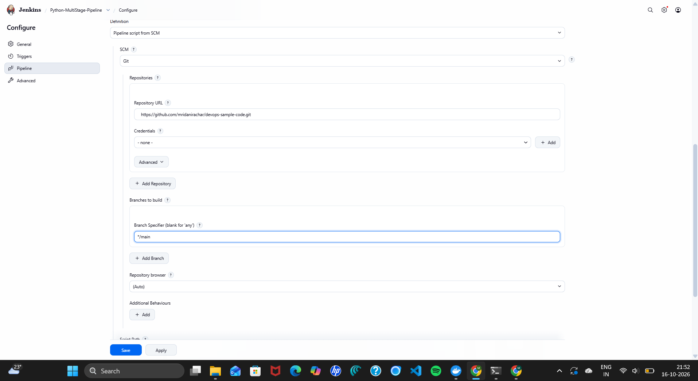

### Step 7: Run the pipeline
**Build Now → build #1 fails**, exactly as the manual predicts in Step 8 (missing Python in the Jenkins container):
```text
+ python3 -m unittest discover -s .
.../script.sh.copy: 1: python3: not found
Stage "Deploy" skipped due to earlier failure(s)
Stage "Run Application" skipped due to earlier failure(s)
Stage "Test Application" skipped due to earlier failure(s)
Pipeline failed. Check the logs for more details.
ERROR: script returned exit code 127
Finished: FAILURE
```
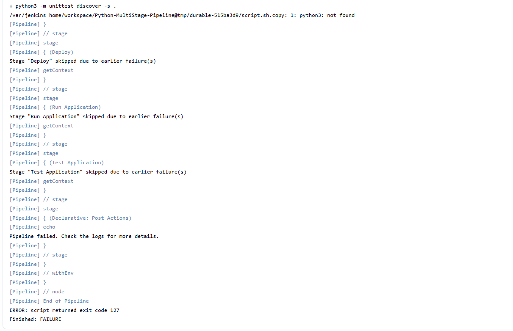

### Step 8: Handling build errors
Log into the Jenkins container as root:
```bash
docker ps -a
docker exec -it -u root jenkins bash
```
Inside the container, `apt-get update` first failed with `Connection refused` to `deb.debian.org:80` (plain http is blocked on this network), so the apt sources were switched to https:
```bash
sed -i 's|http://deb.debian.org|https://deb.debian.org|g' /etc/apt/sources.list.d/debian.sources
apt-get update
```
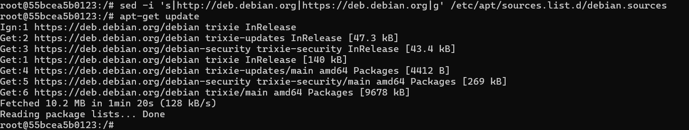

Then the manual's packages `python3`, pip and `python3-flask` were installed (first in one command) and checked:
```bash
apt-get install -y python3 python3-pip python3-flask
python3 -c "import flask; print(flask.__version__)"
```
```text
3.1.1
```
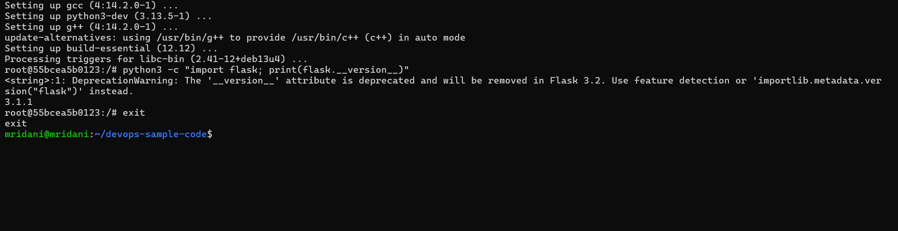

The manual's three install commands, run separately exactly as written, confirm that each package is installed (apt maps `pip` to `python3-pip`):
```bash
apt install python3
apt install pip
apt install python3-flask
```
```text
python3 is already the newest version (3.13.5-1).
Note, selecting 'python3-pip' instead of 'pip'
python3-pip is already the newest version (25.1.1+dfsg-1).
python3-flask is already the newest version (3.1.1-1+deb13u1).
```
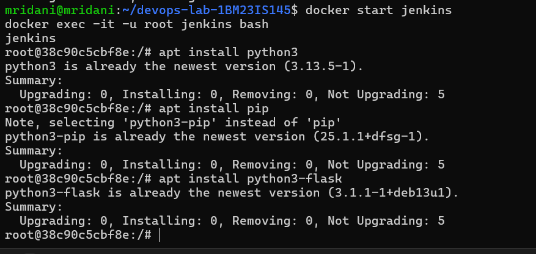

The test command of the Jenkinsfile's Test stage, run by hand in the pipeline workspace:
```bash
cd /var/jenkins_home/workspace/Python-MultiStage-Pipeline
python3 -m unittest discover -s .
```
```text
Hello, Jenkins Multi-Stage Pipeline!
.
----------------------------------------------------------------------
Ran 1 test in 0.019s

OK
```
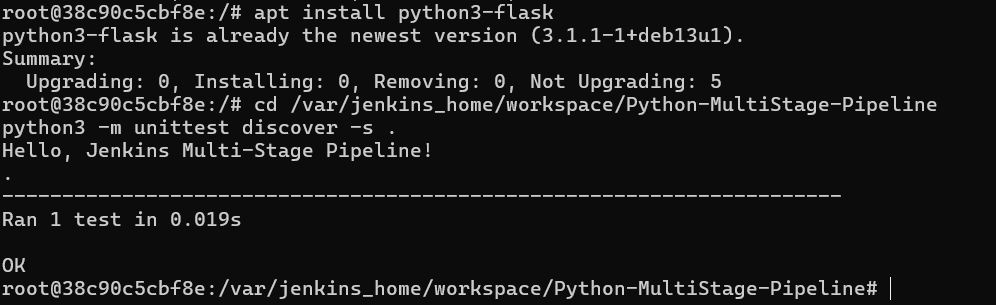

The manual's `apt install python3.11-venv`, run exactly as written, fails because this Jenkins image ships Python **3.13**, not 3.11:
```text
Error: Unable to locate package python3.11-venv
Error: Couldn't find any package by glob 'python3.11-venv'
```
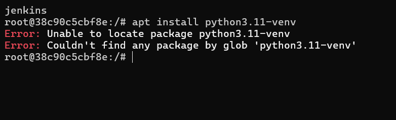

This does not affect the pipeline: the manual's Jenkinsfile never creates a virtual environment (its Build stage only prints a message).

**Build Now → build #2 succeeds:**
```text
[Pipeline] { (Run Application)
Running application...
+ nohup python3 /var/jenkins_home/workspace/Python-MultiStage-Pipeline/python-app-deploy/app.py
[Pipeline] { (Test Application)
Testing application...
+ python3 /var/jenkins_home/workspace/Python-MultiStage-Pipeline/test_app.py
----------------------------------------------------------------------
Ran 1 test in 0.008s

OK
Hello, Jenkins Multi-Stage Pipeline!
[Pipeline] { (Declarative: Post Actions)
Pipeline completed successfully!
Finished: SUCCESS
```
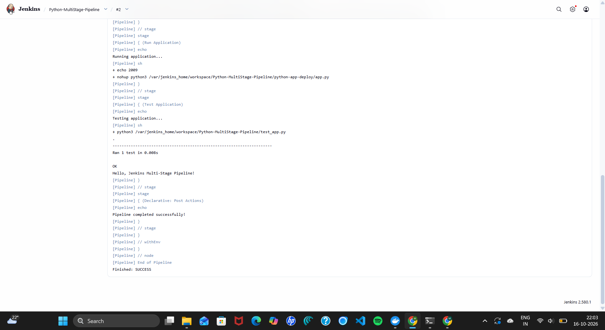

Build history – #1 failed, #2 passed:

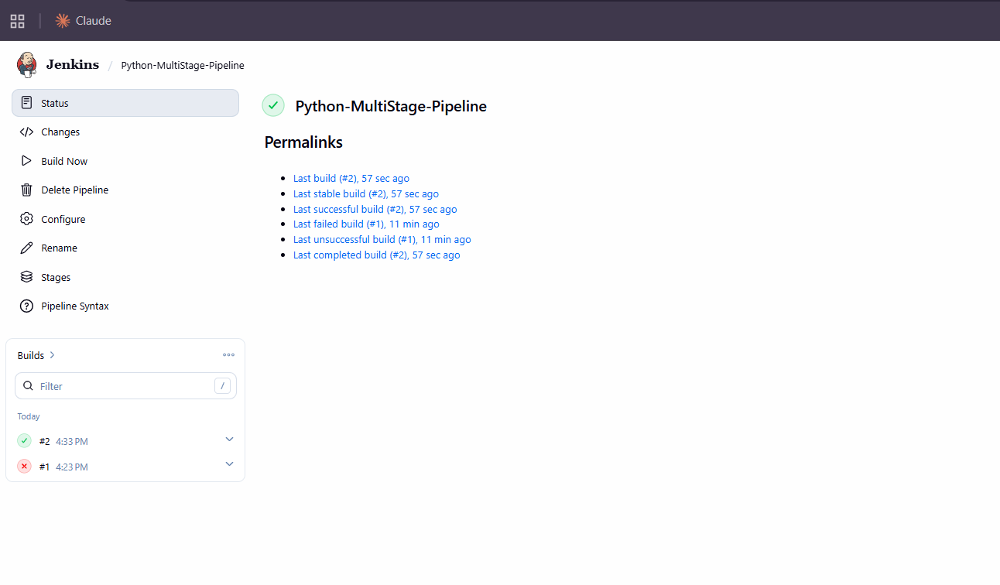

## 6. Expected outcome (from the manual)
| Stage | Expected | Achieved |
|---|---|---|
| Build | Dependencies step runs | ✅ |
| Test | unittest runs and passes | ✅ `Ran 1 test ... OK` |
| Deploy | `app.py` copied to `python-app-deploy` | ✅ |
| Run Application | App started in the background | ✅ `nohup python3 .../app.py` |
| Test Application | Deployed copy tested again | ✅ `OK`, `Hello, Jenkins Multi-Stage Pipeline!` |
| Overall | `Finished: SUCCESS` | ✅ Build #2 |

## 7. Changes from the manual
| Manual | What happened | What was done |
|---|---|---|
| New folder + `git init`, push to `devops-sample-code` | The repository already has the Exercise 8 commit, so the push would be rejected | Files added to the existing local clone |
| Default Branch Specifier `*/master` | The branch is `main` (Exercise 8) | `*/main` |
| `apt-get update` | `Connection refused` to `deb.debian.org:80` | apt sources switched to https |
| `apt install python3.11-venv` | `Unable to locate package` (image has Python 3.13) | Not installed; not used by the pipeline |

## 8. Result
After installing Python in the Jenkins container, all five stages of the manual's Jenkinsfile passed: the unit test ran OK, the app was copied to `python-app-deploy`, started in the background and tested again, ending with `Hello, Jenkins Multi-Stage Pipeline!` and `Finished: SUCCESS`.
