# Exercise 10: Multi-Node Kubernetes Cluster with Multiple Applications

## Aim
Deploy two microservices of an e-commerce platform, Product Catalog (2 replicas) and Shopping Cart (3 replicas), on a 3-node Minikube cluster, with pod anti-affinity so replicas of each service run on different nodes.

## Environment
Windows 11 + WSL2 (Ubuntu 24.04) + Docker Desktop, Minikube v1.39.0 (docker driver, containerd runtime), Kubernetes v1.37.0

## Files
- `product_catalog.py`, `Dockerfile.product` – Product Catalog service (`GET /products`)
- `shopping_cart.py`, `Dockerfile.shopping` – Shopping Cart service (`GET /cart`, `POST /cart`)
- `product_catalog_deployment.yaml` – 2 replicas with `podAntiAffinity`
- `shopping_cart_deployment.yaml` – 3 replicas with `podAntiAffinity`
- `product_catalog_service.yaml`, `shopping_cart_service.yaml` – NodePort Services

## Steps (as per the manual)
0. Clean up: `minikube stop`, `minikube delete`
1. 3-node cluster: `minikube start --nodes 3 -p devops-multinode --force`; registry addon: `minikube -p devops-multinode addons enable registry`
2-4. Create the two Flask apps and Dockerfiles; build both images
5. Load images: `minikube -p devops-multinode image load product-catalog:latest` and `shopping-cart:latest`
6. Apply both deployment YAMLs
7. Apply both service YAMLs
8. Verify distribution: `kubectl get pods -o wide`
9. Access: `minikube -p devops-multinode service product-catalog-service` / `shopping-cart-service` (separate terminals)
10. Test with curl: `GET /products`, `GET /cart`, `POST /cart`

## Deviations from the manual (each one was run as written first)
| Step | Manual | What happened | Fix |
|---|---|---|---|
| 4 | `docker build ...` | `pip install flask` failed inside the build: `Network is unreachable` / `Read timed out` (WSL2 + Docker Desktop networking) | `docker build --network=host ...` |
| 5 | Verify with `minikube -p devops-multinode ssh -- docker images` | `Cannot connect to the Docker daemon` – the nodes use containerd, not Docker | Verified with `minikube -p devops-multinode image ls` |
| 6 | Shopping Cart in `namespace: devops-exercise` | `namespaces "devops-exercise" not found`; its Service is in `default` anyway | Changed to `namespace: default` |

## Screenshots
1. Clean up old cluster: 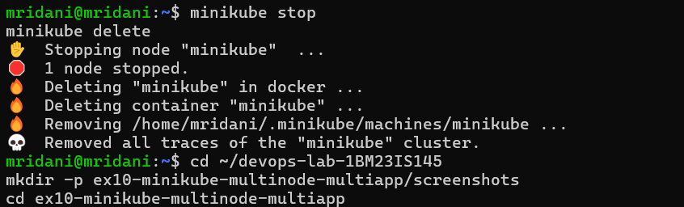
2. 3 nodes Ready + registry addon: 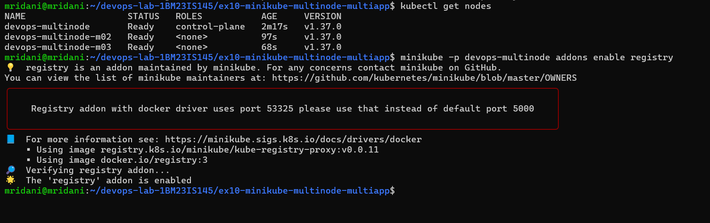
3. Images built: 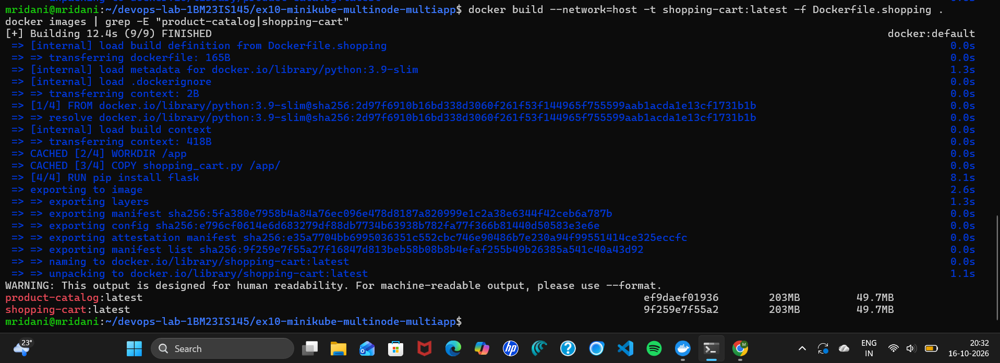
4. Manual's verify command fails (containerd): 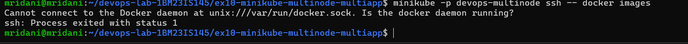
5. Images loaded into the cluster: 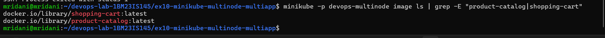
6. Manual's namespace error: 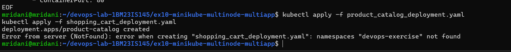
7. Namespace fixed: 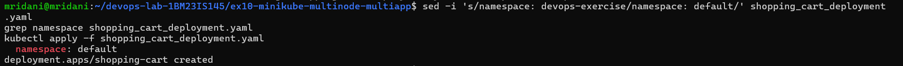
8. Pod distribution across nodes: 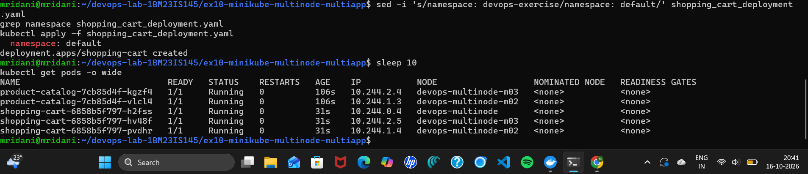
9. NodePort Services: 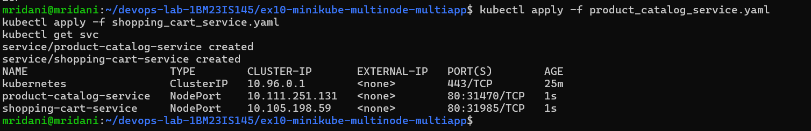
10. Shopping Cart tunnel: 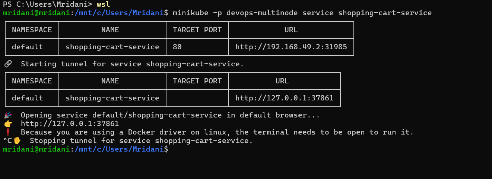
11. Products in browser: 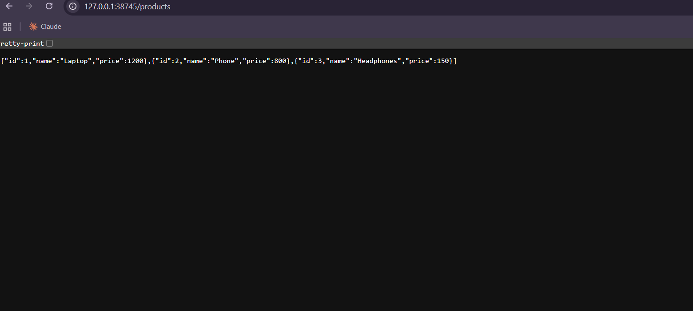
12. curl tests: 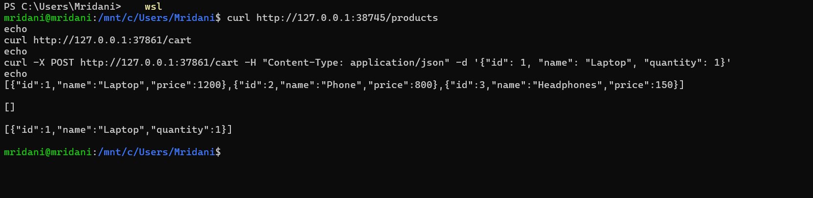
13. Cart state not shared between replicas: 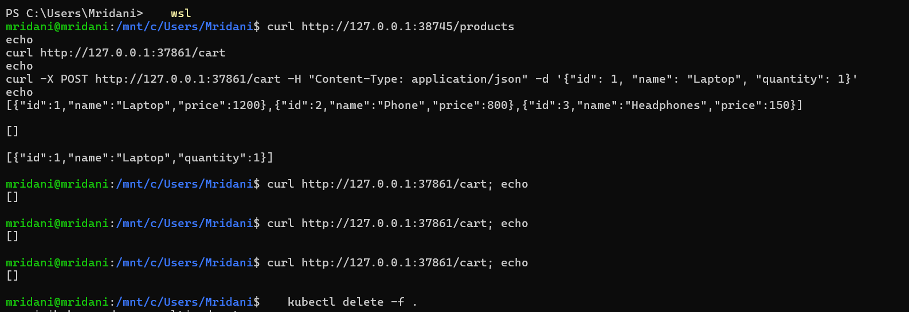

## Observations
- **Pod distribution:** Product Catalog ran on `devops-multinode-m02` and `-m03`; Shopping Cart ran one pod on each of `devops-multinode`, `-m02` and `-m03`. The `requiredDuringSchedulingIgnoredDuringExecution` anti-affinity rule with `topologyKey: kubernetes.io/hostname` forces replicas of the same app onto different nodes, so one node failure cannot take down a whole service.
- **Results matched the manual:** `GET /products` returned 3 products, `GET /cart` returned `[]`, and `POST /cart` returned `[{"id":1,"name":"Laptop","quantity":1}]`.
- **Cart state is per pod:** after the POST, three further `GET /cart` requests all returned `[]`. Each replica keeps its own in-memory `cart` list, and the Service routed the later requests to other replicas. Replicas give availability, but shared state must live outside the pods (e.g. a database or Redis).

## Result
A 3-node Minikube cluster ran two services with 2 and 3 replicas, each replica on a different node, and both services were reachable and tested through NodePort Services.
